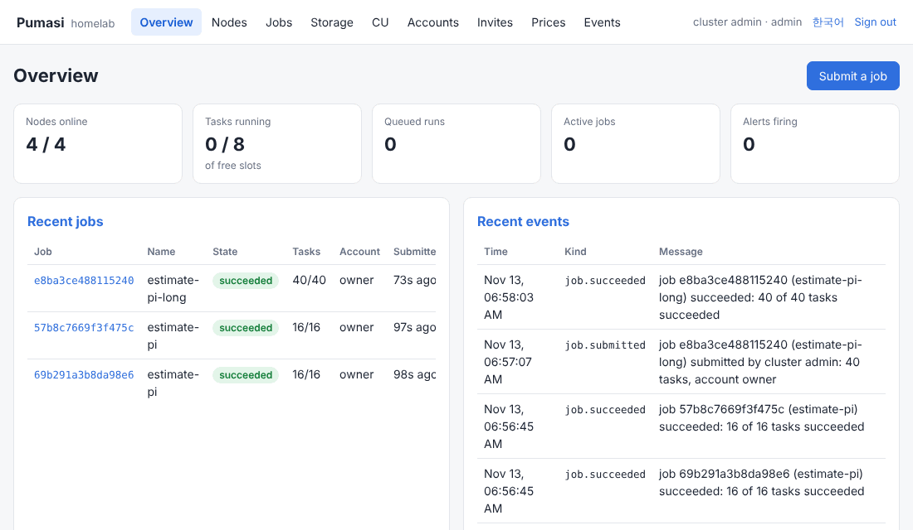
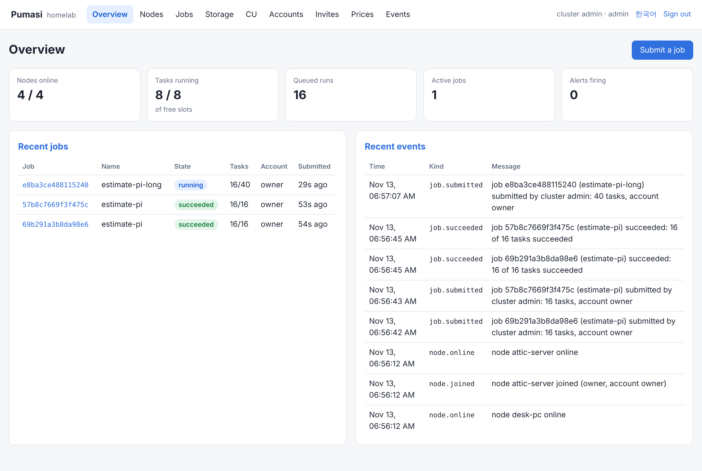

# Pumasi (품앗이)

[](https://github.com/syang0531/pumasi/releases/latest)
[](LICENSE)

**이미 가진 컴퓨터들을 하나의 클러스터로 묶습니다.** 게임용 PC, 업무용 노트북, 구석에 있는 2014년 iMac을 하나의 사설 클러스터로 묶어 배치 작업을 나눠 돌립니다. Linux, macOS, Windows와 x86_64, ARM64에서 같은 Rust 단일 바이너리 하나로 동작합니다. 클라우드 계정도 포트 포워딩도 필요 없습니다. 기기들은 NAT 뒤에서도 서로 연결됩니다.

> [English README](README.md)



*태스크 24개짜리 작업이 도는 동안의 내장 대시보드입니다(Linux 한 대에 에이전트 넷을 띄운 데모 클러스터).*

태스크는 같은 작업 명세로 세 가지 방식 중 하나로 실행됩니다.

- **WebAssembly** 모듈: 샌드박스 안에서, 모든 기기에서 돕니다.
- **Docker** 이미지: Python, 원하는 패키지, GPU, 선택적 네트워크를 쓰며 허용한 기기에서 돕니다.
- **microVM**: 같은 이미지를 태스크마다 자기 커널을 가진 VM 안에서 돌립니다. 남이 빌려준 기기에도 보낼 수 있을 만큼 격리됩니다.

들어 있는 것:

- [Windows](#windows)는 세 실행 방식을 모두 지원하고, [Mac은 구형 Intel Mac까지](#mac-구형-intel-mac까지) 됩니다. 2013~2014년 Mac은 WebAssembly 작업을, macOS 11부터는 microVM 작업도 돌립니다.
- [GPU](#gpu-작업): Docker에서 NVIDIA와 CUDA, 그리고 [WebGPU로 어떤 GPU든](#webgpu-wasm-작업에서-어떤-gpu든-실험)(실험).
- 서버가 아닌 기기: [쉬고 있을 때, 전원에 꽂혀 있을 때, 밤에만](#기기가-일을-받는-때-가용-정책) 일을 받게 할 수 있고, [잠드는 기기](#잠드는-기기)도 다룹니다(Wake-on-LAN 포함).
- [웹 대시보드](#웹-대시보드), [모니터링과 경보](#모니터링과-경보), [파일 저장소](#클러스터-파일-저장소), [k8s 방식의 클러스터 관리](#클러스터-관리)(레이블, 쿼터, 우선순위, 드레인).
- [HTTP API](#어디서든-클러스터-쓰기-http-api): CI, 클라우드 샌드박스, 내 프로그램 등 어디서든 클러스터를 씁니다.
- [다른 사람의 기기](#다른-사람의-기기-초대-컴퓨팅-유닛-검증): 초대로 받고, 서명된 사용 영수증과 결과 표본 검증을 붙입니다.
- [OS 서비스](#에이전트컨트롤-플레인대시보드를-서비스로-실행), [서명된 일괄 업그레이드](#모든-에이전트를-한-번에-업그레이드), [컨트롤 플레인 복제본](#컨트롤-플레인-복제본과-백업), [SSO와 감사 로그](#조직에서-운영하기-sso-감사-로그-운영-문서).

품앗이는 이웃끼리 서로 일을 거들어 주며 품을 갚는 우리 풍습입니다.

**상태.** 지금 1.7이고 아직 젊은 프로젝트입니다. 지금까지는 Windows PC 여러 대(한 대는 RTX 3080)와 2014년 iMac으로 이뤄진 집 클러스터 한 곳에서 2026년 11월부터 쓰고 있습니다. 내부 보안 점검은 마쳤지만 외부 감사는 아직 받지 않았습니다([SECURITY.md](SECURITY.md)). 아직 안 된 것은 [로드맵](#로드맵)에 적어 두었습니다. 버그 제보와 질문은 [이슈](https://github.com/syang0531/pumasi/issues)로 주세요.

## 설치

릴리스마다 Linux(x86_64, aarch64, glibc 2.28 이상이라 2018년 이후 배포판 전부. Alpine은 `--target x86_64-unknown-linux-musl`로 직접 빌드하며 GPU는 못 씀), macOS(x86_64는 10.15부터, Apple Silicon), Windows(x86_64, ARM64)용 `pumasi` 바이너리와 `SHA256SUMS`, 그리고 맞는 바이너리를 받아 체크섬까지 확인하는 설치 스크립트 두 개가 올라갑니다.

```sh
# Linux, macOS: root면 /usr/local/bin, 아니면 ~/.local/bin에 설치
curl -fsSL https://github.com/syang0531/pumasi/releases/latest/download/install.sh | sh
```

```powershell
# Windows: 관리자면 Program Files\Pumasi, 아니면 %LOCALAPPDATA%에 설치하고 PATH에 추가
irm https://github.com/syang0531/pumasi/releases/latest/download/install.ps1 | iex
```

옵션: `--version v1.7.0` / `-Version`, `--dir` / `-Dir`. 참가 티켓을 주면 에이전트를 [서비스](#에이전트컨트롤-플레인대시보드를-서비스로-실행)로도 설치합니다: `curl ... | sudo sh -s -- --ticket pumasijoin... -- --allow-microvm`, 또는 `& ([scriptblock]::Create((irm .../install.ps1))) -Ticket pumasijoin...`. 소스에서 빌드하려면 `cargo build --release -p pumasi-cli`.

## 5분 만에 써 보기

한 대로도 써 볼 수 있습니다. 잘 되면 다른 기기를 더하세요.

```sh
# 1. 한 기기에서: 컨트롤 플레인 시작. 참가 명령이 출력됩니다.
pumasi cluster start --name homelab

# 2. 일을 받을 기기마다(첫 기기도 다른 터미널에서): 출력된 참가 명령을 붙여 넣습니다.
pumasi agent join pumasijoin...

# 3. 관리자 티켓이 있는 곳(기본은 첫 기기)에서:
pumasi status
```

```
cluster homelab (851765067d)

NODE         NAME             STATE     ROLE     PLATFORM       VERSION   EXECUTORS    SLOTS  RUNNING  ...
e993d728f5   attic-server     online    owner    linux/x86_64   1.6.0     wasm             2        0
67d944c4ec   desk-pc          online    owner    linux/x86_64   1.6.0     wasm             2        0
4cf0f33834   mini             online    owner    linux/x86_64   1.6.0     wasm             2        0
8d2920d244   old-laptop       online    owner    linux/x86_64   1.6.0     wasm             2        0

ready for account owner now: wasm 4, docker 0, microvm 0, GPU 0
```

샘플 작업(몬테카를로로 원주율 추정, 16개 샤드)을 돌립니다. WebAssembly 모듈이 빌드된 채로 저장소에 들어 있어서 따로 설치할 것이 없습니다.

```sh
git clone --depth 1 https://github.com/syang0531/pumasi && cd pumasi
pumasi run examples/montecarlo/job.toml --output
```

```
submitted job 5baf22a6d3ea911c (16 tasks)
running: 0/16 done, 8 running, 0 failed
running: 8/16 done, 8 running, 0 failed
succeeded: 16/16 done, 0 running, 0 failed
job 5baf22a6d3ea911c "estimate-pi": succeeded
  executor wasm
  submitted by cluster admin
  account owner  cost 0 CU  deterministic
  tasks 16  succeeded 16  failed 0  fuel 6000109645
  [0] ok node=mini attempts=1 44ms
0 3926363 5000000
  [1] ok node=old-laptop attempts=1 42ms
...
```

샤드 출력은 같은 모듈로 내 컴퓨터에서 합칩니다.

```sh
pumasi run examples/montecarlo/job.toml -o | grep -E '^[0-9]+ ' \
  | pumasi exec examples/montecarlo/montecarlo.wasm reduce
# pi ~= 3.141691 from 80000000 samples in 16 shards
```

이제 대시보드를 엽니다. 바이너리에 들어 있고 내 컴퓨터에서 돕니다.

```sh
pumasi ui
```



다음으로 [Docker에서 Python](#docker-작업-python-파일-그-밖의-무엇이든)을 돌리거나, 재부팅해도 클러스터가 유지되도록 [서비스](#에이전트컨트롤-플레인대시보드를-서비스로-실행)로 설치하거나, [다른 네트워크](#다른-네트워크의-기기와-자체-릴레이)의 기기를 더해 보세요. 샘플을 바꾸려면 `examples/montecarlo/src/main.rs`를 고치고 다시 빌드합니다(명령 두 줄이 그 폴더의 `job.toml`에 있습니다).

## 안내서

### Docker 작업: Python, 파일, 그 밖의 무엇이든

컨테이너를 돌려도 되는 기기의 에이전트를 `--allow-docker`로 시작합니다(그 기기에 Docker가 설치되어 있어야 합니다. Windows는 WSL 2 백엔드에 Linux 컨테이너 모드인 Docker Desktop).

```sh
pumasi agent join pumasijoin... --allow-docker
```

Python 단어 세기 샘플은 스크립트와 텍스트 파일 폴더를 컨테이너 4개에 나눠 보내고, 각 컨테이너가 `/output`에 쓴 결과를 내 컴퓨터로 가져옵니다.

```sh
pumasi run examples/python-wordcount/job.toml --output
python3 examples/python-wordcount/merge.py pumasi-out/<작업 ID>
```

이미지를 돌릴 수 있는 곳이면 어디서든 돌리려면 `executor = "image"`를 씁니다(1.5). 태스크마다 Docker가 있는 노드에서는 Docker로, microVM만 있는 노드(예: 구형 Mac)에서는 microVM으로 돌고, 파일과 출력은 같습니다. `pumasi job ID`가 태스크별로 무엇으로 돌았는지 보여 주고(`as=docker`, `as=microvm`), 요금은 실제로 돈 실행기 기준입니다.

```toml
image = "python:3.12-slim"
executor = "image"
```

### microVM 작업: 내 것이 아닌 기기에서 컨테이너 돌리기

컨테이너는 호스트 커널을 공유하므로 Docker 작업은 내 기기용입니다. microVM 실행기는 같은 OCI 이미지를 태스크마다 가벼운 VM(KVM이 있는 Linux는 [Firecracker](https://firecracker-microvm.github.io/), macOS 11 이상은 Apple Virtualization.framework, Windows는 WHPX 가속 QEMU, 그 밖에는 QEMU) 안에서 자기 Linux 커널로 돌리고, 작업이 요청하지 않으면 네트워크도 없습니다. 작업 명세에는 `executor = "microvm"` 한 줄만 더합니다.

```sh
# 기기마다 한 번 (KVM이 있는 Linux, macOS 11 이상, Windows 10/11 x86_64. Windows는 QEMU를 설치하므로 관리자 터미널에서)
pumasi vm setup
pumasi vm run python:3.12-slim -- python -c 'import platform; print(platform.release())'
# 6.1.102   <- 호스트가 아니라 게스트 커널

pumasi agent join pumasijoin... --allow-microvm
pumasi run examples/python-wordcount/job-microvm.toml --output
```

`pumasi vm setup`은 버전이 고정된 게스트 커널(Linux는 Firecracker, Windows는 QEMU도)을 받아 SHA-256을 확인하고, `pumasi vm status`는 설치 상태와 쓸 VM 모니터를 보여 줍니다. 릴리스 바이너리에는 게스트 init(VM의 PID 1)이 들어 있고, 소스 빌드는 `--guest`로 정적 Linux 빌드(`cargo build --release -p pumasi-guest --target x86_64-unknown-linux-musl`)를 넘깁니다. 에이전트가 이미지를 직접 받고(Docker 불필요) VM 디스크도 직접 포맷하며(e2fsprogs 불필요) 이미지는 VM 안에서 풀기 때문에, 믿을 수 없는 이미지 레이어가 호스트 파일시스템에 닿지 않습니다.

`network = true`면 microVM은 **공인 주소에만** 닿는 네트워크 카드를 받습니다. 카드의 반대편은 호스트 네트워크 장치가 아니라 에이전트 안의 게이트웨이라서, 에이전트가 목적지를 확인한 뒤 연결을 직접 엽니다. 사설 대역(10/8, 172.16/12, 192.168/16, 100.64/10), 루프백, 링크 로컬(클라우드 메타데이터), 멀티캐스트, 예약 대역, 호스트 자신의 주소, 25번 포트로는 절대 연결하지 않습니다. DNS는 호스트의 리졸버로 답하고, 그 밖의 UDP·ICMP·IPv6는 넘기지 않습니다. 네트워크 작업에는 노드에 QEMU가 있거나 macOS 11 이상(Virtualization.framework, Big Sur를 쓰는 2013-2014년 Intel Mac 포함)이어야 하고(Firecracker 노드도 QEMU가 깔려 있으면 그것을 씀, `pumasi vm status`로 확인), 할 수 있는 노드에만 배정됩니다.

### GPU 작업

작업 명세에 GPU를 요청하면 스케줄러가 그만큼 빈 GPU가 있는 노드에 태스크를 놓고, 정확히 그 장치만 넘기며, 쓴 시간을 영수증에 과금합니다.

```toml
image = "pytorch/pytorch:2.5.1-cuda12.4-cudnn9-runtime"
command = ["python", "/input/train.py", "{shard}", "{shards}"]
files = ["train.py"]
shards = 4
gpus = 1                              # 태스크당. "all"이면 노드의 GPU 전부
gpu = { vendor = "nvidia", min_vram_gb = 8 }   # 선택. 쓰면 gpus = 1이 기본
```

```sh
pumasi gpu list                       # 이 기기의 GPU와 벤치마크
pumasi gpu check                      # 작업이 GPU를 쓸 수 있는지, 모자란 것은 어떻게 고치는지
pumasi run examples/pytorch-cuda/job.toml --output
```

- **NVIDIA**: NVML(드라이버에 들어 있는 라이브러리, 있으면 실행 중에 불러옴)로 찾고 CUDA 드라이버로 벤치마크합니다(FP32 처리량, 메모리 대역폭, 클러스터 GPU 검증용 해시 속도). Docker 작업에는 `--gpus device=...`로 넘기므로 Linux는 NVIDIA Container Toolkit이 필요하고, Windows Docker Desktop(WSL 2)은 기본으로 지원합니다.
- **AMD**(Linux): sysfs로 찾고, FP32는 연산 유닛 수와 클럭으로 추정합니다. Docker 작업에는 `/dev/kfd`와 그 GPU의 render 노드를 넘깁니다(ROCm 이미지).
- **Intel·Apple GPU**를 비롯해 CUDA가 없는 GPU는 wasm 작업이 WebGPU로 씁니다(아래).
- **microVM(실험)**: Linux에서 `vfio-pci`에 묶여 있고 IOMMU 그룹이 깨끗하며 화면에 연결되지 않은 GPU는 microVM에 패스스루할 수 있습니다. VM은 GPU용 게스트 커널로 부팅해 자기 NVIDIA 드라이버를 올립니다(`scripts/kernel/build-gpu.sh`로 번들을 만들고 `pumasi vm setup --gpu-bundle DIR`로 설치, 바인딩 명령은 `pumasi gpu check`가 알려 줌). 제공자가 커널을 공유하지 않고 GPU를 빌려줄 수 있습니다.

GPU 시간은 CPU·메모리에 더해 `gpu-tflops-hour`(기본 FP32 1 TFLOPS·1시간당 0.1 CU)와 `gpu-vram-gib-hour`(GPU 메모리 1 GiB·1시간당 0.3 CU)로 과금하므로, 12 GiB·12.7 TFLOPS 카드는 시간당 약 4.9 CU입니다. 내 기기는 잰 값 그대로 과금합니다. 제공자의 GPU는 컨트롤 플레인이 먼저 그 GPU만 빨리 풀 수 있는 챌린지로 시간을 잽니다. 틀린 답은 스트라이크이고 과금도 0, 주장보다 느린 GPU는 잰 만큼만, 챌린지를 못 받는 GPU(CUDA 없음)는 최대 10 TFLOPS로 과금합니다. 검증은 결과 검증 비율로 반복합니다. GPU 결과 자체는 결정적이지 않아 재실행 검증은 하지 않습니다. `pumasi node <id>`로 GPU별 과금 기준을 볼 수 있고, `--no-gpus`로 에이전트의 GPU를 클러스터에서 뺄 수 있습니다.

### WebGPU: wasm 작업에서 어떤 GPU든 (실험)

`gpus = 1`을 요청한 wasm 작업은 WebGPU로 GPU 하나를 받습니다. 에이전트가 [wgpu](https://wgpu.rs)로 기기에 있는 API(Linux는 Vulkan, macOS는 Metal, Windows는 DX12, 대안으로 OpenGL)를 열고, 모듈은 작은 호스트 API인 `pumasi_webgpu` 임포트로 WGSL 컴퓨트 셰이더를 실행합니다. CUDA가 없는 GPU(Intel·AMD 내장 GPU, 구형 Intel Mac의 GPU, Apple Silicon)를 쓰는 유일한 길입니다. 샌드박스는 그대로이고(네트워크 없음, `/input`·`/output` 밖 파일 없음), 작업의 메모리 한도와 제한 시간이 GPU에도 적용됩니다.

```sh
pumasi gpu webgpu                     # 이 기기가 제공하는 어댑터와 벤치마크
cargo build --release --target wasm32-wasip1 --manifest-path examples/webgpu/Cargo.toml
pumasi exec --gpu examples/webgpu/target/wasm32-wasip1/release/matmul.wasm 1024
pumasi agent start --allow-webgpu     # 이 기기의 어댑터를 클러스터에 제공
pumasi run examples/webgpu/matmul.toml --output
```

```toml
module = "matmul.wasm"
gpus = 1                              # 태스크마다 WebGPU 어댑터 하나
gpu = { vendor = "intel" }            # 선택: nvidia, amd, intel, apple, any
```

`examples/webgpu`의 두 예제(타일 행렬곱, PPM 이미지 가우시안 블러)는 GPU 결과를 CPU에서 같은 계산을 돌린 결과와 비교하고 두 속도를 출력합니다. 그 안의 `src/lib.rs`는 호스트 API의 작은 Rust 래퍼라 가져다 쓰면 됩니다. 호출은 `adapter`(GPU 정보 JSON), `shader`(WGSL 컴파일), `buffer`, `write`/`read`, `dispatch`(`@group(0) @binding(0..n)`에 버퍼를 묶고 워크그룹 실행), `wait`, `release`, `error`(실패 이유, WGSL 컴파일 오류 포함)이고, 실패하면 음수를 돌려줍니다. WebGPU와 1:1로 대응하므로 Wasmtime이 컴포넌트 모델의 `wasi:webgpu`(wasi-gfx)를 지원하면 그쪽으로 옮길 수 있습니다.

에이전트는 `--allow-webgpu`일 때만 WebGPU를 제공합니다(제공자도 마찬가지. WebGPU는 브라우저처럼 셰이더를 모두 검증하고 메모리 접근 범위를 검사하지만 GPU 드라이버에 닿기는 합니다). 노드의 GPU 목록에 있는 GPU와 같은 어댑터는 슬롯을 공유하므로 Docker 작업과 WebGPU 작업이 한 GPU를 동시에 쓰지 않습니다. 시간은 다른 GPU처럼 에이전트가 WGSL 셰이더로 잰 FP32 성능으로 과금합니다. WebGPU용 GPU 챌린지는 아직 없어서, 제공자의 어댑터는 클러스터가 이미 시간을 잰 CUDA GPU가 아니면 최대 1 TFLOPS로 과금합니다. GPU마다 결과가 조금씩 달라 이 작업은 결정적이지 않고 재실행 검증도 하지 않습니다. CI는 두 예제를 Linux(소프트웨어 Vulkan 드라이버 lavapipe), Windows, macOS에서 돌려 OS 간 결과를 비교하고, 실제 GPU는 손으로 확인합니다.

### Windows

Windows 10·11(x86_64)에서 모두 동작합니다. WASM은 그대로, Docker는 Docker Desktop으로, microVM은 Windows 하이퍼바이저 플랫폼(WHPX)을 쓰는 QEMU로 돌립니다. 관리자 PowerShell에서:

```powershell
# 한 번만: QEMU가 쓰는 하이퍼바이저 API를 켜고 재부팅
Enable-WindowsOptionalFeature -Online -FeatureName HypervisorPlatform

pumasi vm setup        # 게스트 커널과 버전 고정 QEMU (~\.pumasi\vm\qemu에 설치)
pumasi vm status       # "whpx usable"이면 하드웨어 가속 microVM
pumasi service install --ticket pumasijoin... -- --allow-microvm --allow-docker
```

- WHPX가 없으면(기능이 꺼졌거나 펌웨어에서 가상화가 꺼짐) microVM은 QEMU 소프트웨어 에뮬레이션으로 돕니다. 결과는 같고 몇 배 느립니다. 비교하려면 `PUMASI_QEMU_ACCEL=tcg`로 강제할 수 있습니다. WHPX가 있어도 클라우드 VM처럼 중첩된 환경에서는 VM 디스크가 깨지는데, 에이전트가 시작할 때 작은 프로브 VM을 띄워 보고 그러면 자동으로 에뮬레이션으로 돌리며 로그에 남깁니다.
- Docker 작업에는 WSL 2 백엔드, Linux 컨테이너 모드로 실행 중인 Docker Desktop이 필요합니다. Docker Desktop은 로그인한 사용자와 함께 시작하므로, 아무도 로그인하지 않은 기기는 WASM과 microVM 작업만 받습니다(Docker Desktop 로그인 시 시작과 자동 로그인을 켜면 해결).
- `pumasi service install`은 사설·도메인 네트워크에서 에이전트가 UDP를 받도록 방화벽 규칙을 추가해, 릴레이 대신 직접 연결되게 합니다. `service uninstall`이 규칙을 지웁니다. Windows가 공용(Public)으로 분류한 네트워크에서는 릴레이로 연결되며, 넓히려면 `netsh advfirewall firewall set rule name="Pumasi agent (UDP in)" new profile=any`.
- 에이전트가 띄운 VM과 Docker CLI는 Windows Job Object에 묶여, 에이전트가 비정상 종료해도 함께 끝납니다.
- 1.2.1까지의 `install.ps1`은 `pumasi.exe`를 SYSTEM, Administrators, 설치한 계정만 쓸 수 있게 남겨서, 다른 계정에서 실행하면 "액세스가 거부되었습니다"가 났습니다(서비스는 정상). 더 새 릴리스의 `install.ps1`을 다시 실행하거나 관리자 PowerShell에서 `icacls "C:\Program Files\Pumasi\pumasi.exe" /reset`을 실행하세요.

#### Windows 스마트 앱 컨트롤 (Smart App Control)

Pumasi의 Windows 바이너리는 아직 코드 서명이 없습니다. Windows 11의 스마트 앱 컨트롤은 Microsoft 클라우드가 모르는 서명 없는 프로그램을 막기 때문에, 이 기능이 켜진(평가 모드가 아닌) 기기에서는:

- 새로 받은 `pumasi.exe`를 실행하면 "스마트 앱 컨트롤이 안전하지 않을 수 있는 앱을 차단했습니다"가 뜨고, 바이너리가 막힌 서비스는 시작하지 않습니다.
- `pumasi upgrade rollout`으로 새 바이너리를 받은 에이전트는 바꾸기 전에 실행해 보므로(`--version`) 이전 바이너리로 계속 돌고, `pumasi upgrade status`에 "Windows blocked the new binary: Smart App Control or an App Control policy does not allow it"가 나옵니다. 그 노드만 이전 버전에 머물고 다른 문제는 없습니다.

확인은 Windows 보안 > 앱 및 브라우저 컨트롤 > 스마트 앱 컨트롤 설정, 또는 이벤트 뷰어의 응용 프로그램 및 서비스 로그 > Microsoft > Windows > CodeIntegrity > Operational에서 `pumasi.exe`가 적힌 이벤트 3077로 합니다. 릴리스에 서명이 들어가기 전까지는 그 기기에서 스마트 앱 컨트롤을 끄고 관리자 PowerShell에서 `install.ps1`을 다시 실행하세요. 실행 중인 Pumasi 서비스를 새 바이너리로 재시작합니다(그 노드에서 한 번 실패한 바이너리는 배포가 다시 시도하지 않습니다). `install.ps1`은 받은 바이너리를 바꾸기 전에 한 번 실행해 보므로, 막힌 바이너리가 돌던 바이너리를 덮어쓰지 않습니다. Windows 11 25H2는 나중에 다시 켤 수 있고, 그 전 버전은 Windows를 초기화해야 다시 켤 수 있습니다. App Control for Business나 AppLocker로 관리되는 기기는 관리자가 `pumasi.exe`를 허용해야 합니다.

### Mac, 구형 Intel Mac까지

macOS 10.15 이상이면 어떤 Mac이든 에이전트를 돌릴 수 있습니다. 마지막 macOS가 10.15·11·12인 2013~2014년 Intel 기종도 포함됩니다.

| Mac | 마지막 macOS | WASM | microVM | Docker |
| --- | --- | --- | --- | --- |
| Mac mini(Late 2014), Mac Pro(Late 2013) | 12 Monterey | 가능 | 가능 | 불가 |
| MacBook Air(Mid 2013, Early 2014), MacBook Pro(Late 2013, Mid 2014), iMac(Mid 2014, 5K Late 2014) | 11 Big Sur | 가능 | 가능 | 불가 |
| iMac(Late 2013), MacBook Pro(Early 2013) | 10.15 Catalina | 가능 | 불가 | 불가 |
| Apple Silicon | 최신 | 가능 | 가능 | Docker Desktop으로 가능 |

macOS 11부터 microVM은 macOS에 내장된 Apple Virtualization.framework로 돌아서 따로 설치할 것이 없습니다. `pumasi vm setup`은 게스트 커널을 받고, 바이너리 사본에 서명해 VM 헬퍼로 둘 뿐입니다(이 프레임워크는 서명된 프로그램만 씁니다). Docker Desktop과 Homebrew의 QEMU는 최근 macOS만 지원하므로, 구형 Mac은 WASM과 microVM 작업을 받습니다. macOS가 너무 오래되어 필요한 기능이 안 되는 Mac(Catalina는 microVM 불가, 모두 Docker 불가)에는 Linux를 설치할 수 있습니다. 2013~2014년 기종용 단계별 안내는 [docs/linux-on-old-macs.md](docs/linux-on-old-macs.md)에 있습니다(영문).

```sh
curl -fsSL https://github.com/syang0531/pumasi/releases/latest/download/install.sh | sudo sh
pumasi vm setup        # macOS 11 이상: 게스트 커널 + 서명된 VM 헬퍼
pumasi vm status       # "vz usable"이면 microVM 사용 가능
sudo pumasi service install --ticket pumasijoin... -- --allow-microvm --only-on-ac --idle-minutes 10
```

### 기기가 일을 받는 때 (가용 정책)

사람이 쓰는 기기는 아무도 눈치채지 못할 때만 빌려줄 수 있습니다. 에이전트 옵션(`pumasi service install`에서는 `--` 뒤에):

| 옵션 | 효과 |
| --- | --- |
| `--only-on-ac` | 배터리로 돌 때는 새 작업을 받지 않음 |
| `--idle-minutes 10` | 키보드·마우스 입력이 10분 없을 때만 새 작업을 받음 |
| `--hours 22:00-07:00` | 이 현지 시각 밖에서는 새 작업을 받지 않음(여러 개: `00:00-08:00,12:00-13:00`) |
| `--max-cpu-percent 50` | CPU의 절반만 제공: 더 필요한 이미지 작업은 다른 기기로 가고, 슬롯도 따라 줄어듦 |
| `--slots N` | 동시 작업 수(기본: 제공 CPU당 하나, 단 메모리 2 GiB를 빼고 1 GiB당 하나까지) |
| `--on-pause requeue` | 기기가 일시 정지하면 돌던 태스크를 바로 다른 노드로 옮김(기본 `finish`: 끝까지 실행) |
| `--allow-sleep` | 태스크 실행 중에도 기기가 잠들 수 있게 둠 |
| `--wake-on-lan` | 대기 중인 작업이 있으면 클러스터가 LAN으로 이 기기를 깨울 수 있게 허용 |

일시 정지된 기기는 새 작업을 받지 않고, 돌던 작업은 끝까지 마칩니다(`--on-pause requeue`면 바로 돌려보내며, 태스크의 시도 횟수는 줄지 않습니다). `pumasi status`에 `paused`와 이유(예: "on battery power")가 나옵니다. 유휴 시간은 macOS에서는 기기 전체 기준이라 LaunchDaemon에서도 보이고, Linux에서는 터미널과 데스크톱 세션 기준입니다. Windows 서비스는 키보드·마우스를 볼 수 없으므로, 에이전트 서비스가 로그인한 사용자 세션에 작은 도우미(`pumasi idle-helper`, 창 없음)를 띄워 유휴 시간을 읽습니다. 로그인한 사람이 없으면 유휴로 봅니다. 따로 설정할 것은 없습니다.

### 잠드는 기기

데스크톱과 노트북은 잠듭니다. 1.5부터 에이전트가 이를 처리합니다.

- **태스크가 도는 동안 기기를 깨워 둡니다.** 마지막 태스크가 끝나고 30초 뒤까지입니다(macOS 전원 어서션, Windows 전원 요청, Linux `systemd-inhibit`). 유휴 타이머만 막으므로 덮개, 전원 버튼, 잠자기 메뉴는 그대로 동작하고 화면도 꺼집니다. `--allow-sleep`로 끕니다.
- **잠들기 전에 알립니다.** 컨트롤 플레인이 노드 타임아웃을 기다리지 않고 그 기기의 태스크를 바로 다른 노드로 옮기고(시도 횟수는 줄지 않음), 노드를 `offline`이 아니라 `asleep`으로 표시합니다. `node_offline` 경보도 울리지 않습니다. 기기가 깨면 에이전트가 스스로 다시 연결합니다.
- **대기 작업이 있으면 클러스터가 깨웁니다**(Wake-on-LAN). 에이전트를 `--wake-on-lan`으로 실행한 기기만 해당합니다. 온라인 노드 중 아무도 못 돌리는 작업이면 바로, 바쁜 노드를 기다리는 작업이면 `--wake-after`(컨트롤 플레인 옵션, 기본 `10m`, `never`로 끔) 뒤에 깨웁니다. 직접 깨우려면 `pumasi node wake 노드` 또는 대시보드 노드 화면의 **깨우기** 버튼을 씁니다.

```sh
pumasi service set -- --wake-on-lan            # 깨울 기기에서
pumasi node laptop                             # 네트워크 카드와, 클러스터가 깨울 수 있는지
pumasi node wake laptop
```

매직 패킷은 공유기를 넘지 못하므로, 잠든 기기와 같은 LAN에 있는 클러스터 기기가 보냅니다. 컨트롤 플레인이 그 LAN에 있으면 직접 보내고, 온라인 에이전트(1.5 이상) 최대 둘에게도 부탁합니다. 그 LAN에 클러스터 기기가 하나뿐이면 깨울 수 없습니다. 에이전트는 기기 설정을 바꾸지 않으니 Wake-on-LAN을 한 번 켜 두세요.

| 기기 | 설정 |
| --- | --- |
| Mac | 시스템 설정 > 에너지(노트북: 배터리 > 옵션) > **네트워크 연결 시 깨우기**, 또는 `sudo pmset -a womp 1`. 노트북은 전원에 연결되어 있을 때만 깨고, 유선(Thunderbolt·USB 어댑터 포함)이라야 확실합니다. |
| Windows | 장치 관리자 > 네트워크 어댑터 > **전원 관리**: "이 장치를 사용하여 컴퓨터의 대기 모드를 해제할 수 있음"과 "매직 패킷에서만 컴퓨터의 대기 모드를 해제할 수 있음". **고급**: "Wake on Magic Packet" 사용. 종료 상태에서도 깨우려면 빠른 시작을 끕니다(제어판 > 전원 옵션 > 전원 단추 작동 설정). |
| Linux | `sudo ethtool -s eth0 wol g`. 유지하려면 `nmcli connection modify "Wired connection 1" 802-3-ethernet.wake-on-lan magic`. |
| BIOS / UEFI (PC) | "Wake on LAN"("Power on by PCI-E", "Resume by LAN"이라고도 함)을 켜고, 네트워크 카드 전원을 끊는 "ErP"나 "Deep sleep"을 끕니다. |

Wi-Fi 카드는 매직 패킷으로 거의 깨어나지 않습니다. `pumasi node 노드`가 Wi-Fi 카드를 표시해 주며, 유선 연결을 써야 합니다.

### 다른 사람의 기기: 초대, 컴퓨팅 유닛, 검증

친구가 자기 PC를 내 클러스터에 빌려줄 수 있습니다. 그 사람의 계정 이름으로 초대합니다.

```sh
pumasi invite bob                  # bob이 자기 기기에서 실행할 `pumasi agent join pumasijoin...` 출력
pumasi cu add owner 100            # 남의 기기에서 돌린 작업에 쓸 100 CU
pumasi run examples/montecarlo/job.toml
```

- bob의 기기는 **제공자**로 참가합니다. WASM 작업과, bob이 에이전트를 `--allow-microvm`으로 띄웠다면 microVM 작업을 받고(Docker는 초대할 때 `--allow-docker`를 주고 bob도 에이전트를 `--allow-docker`로 띄운 경우에만), CU가 있는 계정의 작업만 받습니다.
- 내 기기를 먼저 쓰고 비용은 없습니다. 넘치는 작업이 제공자에게 갑니다. 제공자 실행은 **컴퓨팅 유닛(CU)**으로 값을 매겨(아래) 작업 계정에서 차감하고, 제공자 수익은 **보류**(기본 1시간)했다가 사용 가능 잔액으로 옮깁니다.
- 실행마다 **사용 영수증**(fuel, 실행 시간, 메모리, 실행기, 결과 해시, 과금한 CPU 점수와 CU)이 나오고, 노드가 서명하고 컨트롤 플레인이 맞서명합니다. `pumasi receipts <작업 ID> --export r.json`으로 내보내고 `pumasi verify-receipts r.json`으로 오프라인 검증합니다.
- WASM 작업은 기본으로 **결정적 모드**(가상 시계, 시드 고정 난수)로 돌아 정직한 노드라면 같은 결과를 냅니다. 제공자가 돌린 태스크 일부(10%, 새 제공자는 50%, 검증에 한 번 걸린 제공자는 전부)를 **다른 노드에서 다시 돌려** 비교하고, 가능하면 내 기기에서 돌립니다. 결과가 다르면 그 수익은 몰수(작업 계정에 환불)되고 스트라이크가 쌓이며, 3번이면 더는 작업을 받지 못합니다. 검증 실행의 결과가 맞으면 그 결과로 바꿔 줍니다.

CU는 장부일 뿐이고 엔진은 돈을 모릅니다. `pumasi cu payout bob 10`은 10 CU가 장부에서 빠졌다는(Pumasi 밖에서 bob에게 정산했다는) 기록입니다.

### 컴퓨팅 유닛과 벤치마크

**1 CU는 기준 vCPU 1개를 1시간 쓰는 값**입니다. 기준 vCPU는 CPU 점수 1000(2.5 GHz Skylake급 서버 코어의 하드웨어 스레드 1개)입니다. 다른 자원은 따로 단가가 있고 `pumasi prices set`으로 바꿉니다.

| 자원 | 기본 단가 |
| --- | --- |
| CPU (Docker, microVM) | 점수 1000 기준 vCPU-시간당 1 CU |
| WASM | fuel이 나타내는 기준 시간 1시간당 1 CU |
| 메모리 | 예약한 GiB-시간당 0.25 CU |
| 저장소(클러스터 파일 저장소) | GiB-월당 0.5 CU |
| 이그레스 | GiB당 0.1 CU |

그래서 1 vCPU + 2 GiB를 1시간 쓰면 1.5 CU, 1 vCPU + 4 GiB면 2 CU입니다. 원장은 정수 milli-CU이고, 실행 한 번의 값 중 1 milli-CU가 안 되는 부분은 같은 두 계정 사이의 다음 실행으로 넘어가서 짧은 실행이 많아도 합계가 정확히 맞습니다.

에이전트는 시작할 때(저장된 프로필이 오래됐으면) 그리고 하루마다 한가할 때 기기를 **벤치마크**하고(`--bench-interval`, `--no-benchmark`), 노드 키로 서명해 보냅니다.

- **CPU**: 작업이 도는 것과 같은 WASM 샌드박스에서 고정 정수 커널을 스레드 1개와 제공하는 CPU 전부로 돌려 점수로 냅니다.
- **메모리**: 복사 대역폭.
- **디스크**(에이전트 디렉터리가 있는 드라이브): 페이지 캐시를 우회한 fio 방식으로 순차 읽기·쓰기, 4 KiB 랜덤 읽기를 하나씩(지연)과 8개씩(IOPS). 탐색 지연과 속도로 HDD(`hdd`), SATA SSD(`ssd`), `nvme`를 구분합니다.
- **SMART**: `smartctl`이 있으면 건강 상태, 마모도(정격 수명 중 쓴 비율), 사용 시간, 매체 오류.
- **지연**: 컨트롤 플레인이 노드마다 연결의 왕복 시간을 직접 잽니다(직접 연결인지 릴레이인지도).

CPU 시간은 **실행 시간 × 점수 / 1000**으로 과금하므로, 느린 기기에서 오래 걸려도 빠른 기기와 CU가 거의 같습니다. WASM은 어디서나 같은 fuel로 과금합니다. 제공자가 CPU를 부풀려 신고해도 소용없습니다. 컨트롤 플레인이 직접 재기 전에는 최대 1000으로 과금하고, 제공자가 한가할 때 벤치마크 커널용 새 시드를 보내 응답 시간을 직접 재고 답을 다시 계산합니다. 과금 점수는 잰 값의 1.25배를 넘지 않고, 잰 값의 2배가 넘는 신고나 틀린 답은 스트라이크입니다. 빨라 보이려고 실행 시간을 짧게 보고해도 이득이 없습니다. 과금이 시간 × 점수이기 때문입니다.

```
$ pumasi bench
cpu      Intel(R) Core(TM) i5-4250U CPU @ 1.30GHz (4 threads)
         score 811 single-thread, 2035 all threads, 508 per vCPU (reference vCPU = 1000)
memory   4.0 GiB, copy 9120 MB/s
disk     ssd (the OS says ssd)
         sequential 512 MB/s read, 431 MB/s write; 4 KiB random read 96 us median, 180 us p99, 31150 IOPS (8 in flight)
smart    APPLE SSD SM0128F, health ok, 7% of endurance used, 21530 h powered on, 0 media errors
```

`pumasi status`에 노드별 과금 점수, 디스크 종류, 지연이 나오고, `pumasi node <ID>`에 전체 프로필과 클러스터가 잰 결과가 나오며, `pumasi node <ID> --rebenchmark`로 다시 재게 할 수 있습니다.

**품앗이(mutual) 모드.** 돈 없이 기기를 서로 빌려 쓰는 그룹용입니다. `pumasi prices set --ledger mutual --credit-limit 20`. 아무도 CU를 지급하지 않고, 내 기기를 빌려주면 CU를 벌고 남의 기기를 쓰면 씁니다. 잔액은 신용 한도만큼 마이너스까지 갈 수 있고, 모든 잔액의 합은 항상 0입니다.

### 다른 네트워크의 기기와 자체 릴레이

기기는 어디서든 참가합니다. 집, 사무실, 클라우드 VM, NAT 뒤 모두 되고 포트포워딩도 필요 없습니다. 에이전트와 CLI는 항상 컨트롤 플레인으로 먼저 연결하고, 연결은 키로 서로 인증하는 종단 간 암호화 iroh QUIC입니다. 먼저 직접 연결(홀펀칭)을 시도하고, 안 되면 암호화된 패킷만 전달하는 릴레이를 거칩니다. 노드마다 직접 연결인지 릴레이인지는 `pumasi status`에 나옵니다.

기본 릴레이는 n0(iroh 개발사)의 공개 릴레이입니다. 자체 릴레이를 쓰려면 모두가 닿을 수 있는 기기에 같은 메이저 버전(1.x)의 [iroh-relay](https://github.com/n0-computer/iroh/tree/main/iroh-relay) 서버를 띄우고 컨트롤 플레인을 그것으로 시작합니다.

```sh
pumasi cluster start --name homelab --relay https://relay.example.com
```

그러면 참가·관리자 티켓에 그 릴레이가 들어가서, 에이전트와 `pumasi login`, `pumasi ui`, 복제본이 옵션 없이 알아서 씁니다(에이전트에 `--relay`를 주면 그것이 우선). `--relay`는 컨트롤 플레인을 시작할 때마다(서비스 정의에) 주고, 여러 개면 반복합니다. 주소 조회는 여전히 서명된 주소 기록을 n0의 DNS에 올립니다. 인터넷이 없는 LAN에서는 `--net local`이 릴레이와 조회를 끕니다.

### 에이전트·컨트롤 플레인·대시보드를 서비스로 실행

`pumasi agent join`은 터미널을 차지하고 돕니다. 재부팅해도 클러스터에 다시 붙게 하려면 서비스로 설치합니다.

```sh
sudo pumasi service install --ticket pumasijoin... -- --allow-microvm
pumasi service status
```

| OS | root·관리자로 설치 | 일반 사용자로 설치 |
| --- | --- | --- |
| Linux | systemd 유닛 `/etc/systemd/system/pumasi-agent.service`, 부팅 시 시작 | `systemctl --user` 유닛, lingering을 켜서 부팅 시 시작 |
| macOS | LaunchDaemon `/Library/LaunchDaemons/pumasi.agent.plist`, 부팅 시 시작 | LaunchAgent, 로그인 시 시작 |
| Windows | Windows 서비스 `pumasi-agent` (자동 시작, 실패 시 재시작) | 관리자 PowerShell 필요 |

`--ticket`은 첫 시작 때 클러스터에 참가하고, 없으면 이미 참가한 기기여야 합니다. `--` 뒤의 옵션은 `pumasi agent start`로 넘어갑니다. 로그는 Linux는 journal, macOS와 Windows는 `~/.pumasi/logs/agent.log`입니다. `pumasi service uninstall`은 서비스만 지우고 멤버십은 남깁니다(퇴출은 `pumasi remove-node`).

옵션은 에이전트 홈의 `agent.toml`에 저장되고, 서비스가 시작할 때마다 읽습니다. 다시 설치하지 않고(참가 티켓도 없이) 옵션을 보고 바꿀 수 있습니다.

```sh
pumasi service status                 # ... options:  --allow-docker --name den
sudo pumasi service set -- --allow-webgpu --no-allow-docker --slots 6
```

`service set`은 적어 준 옵션만 바꾸고 나머지는 그대로 두며, 결과를 `agent start`와 같은 방식으로 검사한 뒤 서비스를 재시작합니다. `--이름 [값]`은 옵션을 더하거나 바꾸고, `--no-이름`은 뺍니다. `--dry-run`은 바꾸지 않고 결과만 보여 줍니다. `service set cluster`, `service set ui`는 나머지 두 서비스에 같은 일을 합니다(`control-plane.toml`, `ui.toml`). 1.4 이전 릴리스로 설치한 서비스는 옵션이 서비스 정의 안에 있습니다. `service status`가 그렇게 알려 주고, 처음 `service set`을 하면 파일로 옮깁니다. Windows에서도 재설치나 재부팅이 필요 없습니다. 옮긴 뒤에는 서비스가 pumasi 1.4 이상을 필요로 하므로, 기기를 이전 릴리스로 되돌리려면 그 릴리스로 서비스를 다시 설치하세요.

컨트롤 플레인과 대시보드(또는 원격 API)도 같은 방법으로 설치합니다. 그러면 1번 기기를 재부팅해도 클러스터가 다시 뜹니다.

```sh
sudo pumasi --home ~/.pumasi service install cluster -- --name homelab
sudo pumasi --home ~/.pumasi service install ui -- --api-only
pumasi service status          # 이 기기의 Pumasi 서비스 모두
```

- `cluster`는 `pumasi cluster start`를 돌리고(서비스 `pumasi-cluster`, launchd 레이블 `pumasi.cluster`), 시작할 때마다 참가 티켓이 로그에 남지 않도록 `--no-token`을 붙입니다. 참가 티켓은 `pumasi token`으로 만드세요. 터미널에서 돌던 `cluster start`는 먼저 멈춥니다.
- `ui`는 `pumasi ui`를 돌립니다(서비스 `pumasi-ui`). `--listen`이 없으면 127.0.0.1:7400이고 브라우저는 열지 않습니다. 대시보드 로그인 링크는 시작할 때 `~/.pumasi/ui.url`에 씁니다. 대시보드와 API를 Cloudflare Tunnel 뒤 한 주소로 열려면 `service install ui -- --login-only --public-url https://pumasi.example.com --real-ip-header CF-Connecting-IP`로 설치합니다([docs/api.md](docs/api.md)의 "Put it on the internet").
- 이 둘을 시스템 서비스로 설치하면 홈 디렉터리 소유자 계정으로 돕니다(systemd `User=`, launchd `UserName`). 그래서 관리자 티켓 파일이 계속 내 것입니다. `--home`은 `service install` 앞에 주세요. `sudo` 아래에서는 따로 말하지 않으면 root의 홈을 씁니다. Windows에서는 LocalSystem으로 돌고, `pumasi-cluster`에도 에이전트처럼 방화벽 규칙을 넣습니다.
- `pumasi service uninstall cluster`(또는 `ui`)로 지웁니다. 클러스터 데이터는 남습니다.
- `sudo pumasi service restart`(Windows는 `sudo` 없이 관리자 PowerShell)는 이 기기의 Pumasi 서비스를 컨트롤 플레인부터 모두 멈췄다가 다시 시작합니다. `service restart cluster`(또는 `ui`, `agent`)는 하나만 재시작합니다. 컨트롤 플레인을 재시작하면 에이전트와 대시보드가 스스로 다시 붙고, 실행 중이던 태스크는 노드에 다시 배정됩니다. 에이전트를 재시작하면 그 노드의 태스크가 멈춥니다. 서비스 관리자의 명령(`systemctl restart pumasi-cluster`, `launchctl kickstart -k system/pumasi.cluster`, `Restart-Service pumasi-cluster`)도 됩니다. 중지 요청을 받고도 멈추지 않는 서비스는 강제로 끝납니다. systemd는 30초, launchd는 20초 뒤에 끝내고, 서비스 관리자가 끝없이 기다리는 Windows에서는 서비스가 30초 뒤에 스스로 끝납니다.

macOS에서 `curl ... | sudo sh -s -- --ticket ...`으로 설치하면 에이전트가 root로 도는 LaunchDaemon이 되고 상태는 root의 홈에 둡니다. 옵션에 `--allow-microvm`이 있으면 스크립트가 `pumasi vm setup`을 먼저 합니다. 그 에이전트에 대한 명령은 `sudo`로 하세요(`sudo pumasi vm setup`, `sudo pumasi service status`). 1.1.0 이하에서 이렇게 설치한 에이전트는 root 소유의 `~/.pumasi`를 계속 씁니다.

### 모든 에이전트를 한 번에 업그레이드

관리자 티켓이 있는 곳에서 실행합니다(대시보드 노드 화면의 업그레이드 버튼, `POST /api/v1/upgrade`도 같습니다).

```sh
pumasi upgrade latest --check     # 최신 릴리스와 노드별 버전
pumasi upgrade latest --wait      # 또는 --version v1.3.0
pumasi upgrade latest --canary imac --canary-soak 1h   # imac 먼저, 나머지는 한 시간 뒤
```

`--canary 노드|셀렉터`(1.7)를 주면 그 노드가 먼저 업그레이드되고, 카나리가 새 바이너리로 `--canary-tasks`개 작업을 문제없이 마치고 `--canary-soak`(기본 30분)이 지나면 나머지가 따라갑니다. 카나리가 설치에 실패하거나 노드 오류를 내면 `pumasi upgrade promote [노드...]`(더 많은 노드, 또는 전체)나 `pumasi upgrade cancel` 전까지 멈춥니다. `--canary-hold`는 항상 promote를 기다립니다. 대시보드 업그레이드 패널에서 체크박스로 카나리를 고르고 상태를 봅니다.

컨트롤 플레인이 GitHub 릴리스에서 노드들이 쓰는 플랫폼의 바이너리를 받아, 릴리스의 `SHA256SUMS`, 실행 파일 헤더(플랫폼), 빌드 표식(버전)과 맞는지 확인한 뒤 아래와 같이 배포합니다. 이미 그 버전 이상인 노드는 건드리지 않습니다. 컨트롤 플레인과 대시보드는 자기 바이너리를 지켜보다가 롤아웃이 끝나면 새 버전으로 스스로 재시작합니다(`--no-follow-binary`로 끔, 대시보드에 로그인한 브라우저는 다시 로그인). 같은 PC의 에이전트가 멤버이면 에이전트가 바이너리를 설치하고, 컨트롤 플레인만 도는 PC(에이전트가 없거나 `pumasi remove-node`로 뺀 PC)에서는 컨트롤 플레인이 자기 플랫폼용 릴리스도 받아 직접 설치합니다. `pumasi cluster start --release-source URL`로 다른 GitHub 릴리스 주소를 쓸 수 있습니다.

가진 바이너리를 배포하려면(다른 빌드, 인터넷이 안 되는 컨트롤 플레인) 직접 받아서 배포합니다.

```sh
pumasi upgrade rollout pumasi-linux-x86_64 pumasi-macos-aarch64 pumasi-windows-x86_64.exe --wait
pumasi upgrade status
```

플랫폼과 버전은 파일에서 읽습니다. 컨트롤 플레인이 바이너리마다 클러스터 키로 서명하고, 에이전트는 자기가 참가한 클러스터가 서명했고, 자기 플랫폼용이며, 서명된 크기와 SHA-256이 맞고, 새 바이너리가 실제로 뜨는(`--version`) 경우에만 설치합니다. 내 기기는 기본으로 받고(`--no-auto-upgrade`로 거부), 남의 기기는 주인이 에이전트를 `--auto-upgrade`로 띄운 경우에만 받습니다. 쉬는 노드는 바로, 바쁜 노드는 한 대씩 새 작업을 멈추고 비운 뒤 교체합니다. 에이전트는 제자리에서 재시작하고, 새 바이너리를 클러스터가 거부하거나, 5분 동안 클러스터에 못 붙거나, 계속 죽으면 이전 바이너리로 되돌리고 실패를 `pumasi upgrade status`에 보고합니다. 컨트롤 플레인을 먼저 업그레이드하세요(멈추고 바이너리 교체 후 시작). 프로토콜 버전이 다른 바이너리는 `--force`가 필요하고, 그 에이전트들은 롤백됩니다. 배포는 `pumasi upgrade cancel` 전까지 유지되지만 버전을 내리지는 않습니다(이미 더 새 버전을 도는 노드는 그대로).

### 클러스터 파일 저장소

컨트롤 플레인은 `~/.pumasi/cluster/blobs`에 내용 주소(iroh-blobs, BLAKE3) 저장소를 둡니다. 데이터셋은 이름과 버전이 있고, 다른 버전과 겹치는 파일은 한 번만 저장합니다.

```sh
pumasi store put corpus texts/ extra.csv --account alice   # corpus@1, 없는 부분만 보냄
pumasi store ls                                            # 데이터셋별 최신 버전
pumasi store get corpus@1 -o corpus/                       # 끊겨도 다시 실행하면 이어받음
pumasi store rm corpus@1                                   # 쓰는 작업이 없어지면 공간 회수
pumasi store usage                                         # 계정별 사용량·쿼터, 디스크 사용량
pumasi store quota alice 100G
```

작업은 `files`의 `store:` 항목으로 데이터셋을 읽고, 출력을 데이터셋으로 남길 수 있습니다.

```toml
name = "tokenize"
module = "tokenize.wasm"
shards = 16
files = ["store:corpus/part-{shard:02}.txt", "store:vocab@2"]  # /input/corpus/, /input/vocab/ 아래
args = ["/input/corpus/part-{shard:02}.txt"]
output = "store:tokens"            # 모든 태스크의 /output이 데이터셋 tokens@N이 됨
```

`store:이름[@버전][/경로]`는 데이터셋(또는 그 안의 파일·폴더 하나)을 `/input/이름/`에 놓습니다. `{shard}`를 쓰면 태스크마다 자기 몫만 받으므로 큰 데이터셋을 여러 노드가 나눠 읽습니다. 노드는 받은 데이터를 로컬 캐시(`--store-cache`, 기본 20 GiB, 오래 안 쓴 것부터 지움)에 두고, 이미 가진 다른 노드가 있으면 거기서, 없으면 컨트롤 플레인에서 받으며, 끊기면 받은 데서부터 이어받습니다. 모든 조각은 BLAKE3 해시로 검증합니다.

입출력이 메시지 하나에 들어갈 필요가 없어졌습니다. `pumasi run`은 16 MiB가 넘는 로컬 `files`를 저장소로 보내고, 32 MiB가 넘는 `/output`은 보고 대신 저장소로 갑니다(`output = "store:..."`면 전부). 작업이 끝나면 저장된 출력은 데이터셋 `job-<id>`(또는 지정한 이름)가 되고, `pumasi run`, `pumasi job --out`, `pumasi store get --job <id>`로 받습니다.

저장 용량은 데이터 주인 계정에 GiB-월당 CU로 과금하고, 단가는 컨트롤 플레인 디스크 등급을 따릅니다(`cluster start --storage-class hdd|ssd|nvme`, `prices set --storage-hdd-gib-month`, SSD는 `--storage-gib-month`, `--storage-nvme-gib-month`). `store get` 다운로드는 이그레스로 과금합니다. `prices set --default-quota 50G`는 따로 쿼터가 없는 계정의 상한입니다.

**비공개 이미지.** 레지스트리 로그인을 클러스터 비밀로 넣으면 그 레지스트리의 이미지를 Docker와 microVM 작업에서 쓸 수 있습니다.

```sh
pumasi secret set registry/ghcr.io 'user:token'     # 값을 빼면 stdin에서 읽음
pumasi secret ls                                    # 이름만, 값은 안 보여줌
```

컨트롤 플레인이 이미지를 저장소로 받고 노드는 거기서 불러오므로, 로그인 정보는 컨트롤 플레인 밖으로 나가지 않고, 이미지 레이어는 노드끼리 나눠 받습니다.

### 클러스터 관리

작업을 어디서 돌릴지, 무엇을 먼저 돌릴지, 계정마다 얼마나 쓰게 할지를 Kubernetes처럼 CLI에서 정합니다.

**라벨과 selector.** 노드마다 내장 라벨(`name`, `os`, `arch`, `role`, `account`, `executor`, `gpu`, `gpus`, `disk`)과 직접 붙인 라벨이 있습니다. 작업의 `selector`에 맞는 노드에서만 돕니다.

```sh
pumasi label desktop zone=home tier=fast      # `zone-`는 라벨 삭제
pumasi get nodes -l 'os=linux,disk=nvme|ssd'
```

```toml
# job.toml
[selector]
os = "linux"
disk = ["nvme", "ssd"]           # 이 중 하나
gpu = "!amd"                     # 이것만 아니면
zone = true                      # 라벨이 있기만 하면 (false: 없어야 함)
```

**테인트.** 테인트가 붙은 노드는 그 테인트를 허용(toleration)하는 작업만 받습니다. GPU 기기를 GPU 작업 전용으로 둘 때 씁니다(`pumasi taint desktop gpu-only` 후, 거기 가도 되는 작업에 `tolerations = ["gpu-only"]`; `key-`는 삭제).

**cordon과 drain.** `pumasi cordon 노드`는 새 작업을 보내지 않고, `pumasi drain 노드`는 실행 중인 태스크까지 다른 노드로 옮기며(작업의 시도 횟수에 세지 않음), `pumasi uncordon 노드`로 되돌립니다. 점검 전에 씁니다.

**우선순위와 선점.** job.toml의 `priority = 10`(또는 `pumasi run --priority 10`, -1000~1000, 기본 0)은 큐에서 낮은 작업보다 앞섭니다. 자리가 없으면 높은 태스크가 필요한 만큼 가장 적고 가장 덜 중요한 실행 중 태스크를 멈추고, 멈춘 태스크는 시도 횟수를 잃지 않고 큐로 돌아갑니다.

**쿼터.** 계정마다 동시 태스크 수, GPU 수, 24시간 동안 쓰는 CU, 쓸 수 있는 최고 우선순위, 파일 저장소 용량을 제한합니다. 쿼터를 넘는 작업은 계정이 다시 쿼터 안으로 들어올 때까지 큐에서 기다립니다.

```sh
pumasi quota alice --slots 8 --gpus 1 --cu-per-day 50 --max-priority 10 --storage 100G
pumasi quota                                   # 모든 계정의 한도와 사용량
pumasi quota alice --add-images 'node:22-slim' # 허용 이미지 하나 추가, 나머지는 그대로
```

대시보드의 **계정** 페이지에서도 같은 쿼터와 작업 정책을 보고 고칠 수 있고, `PATCH /api/v1/accounts/이름/policy`는 보낸 필드만 바꿉니다([docs/api.md](docs/api.md)).

**역할 티켓.** 관리자 티켓 대신 사람마다 티켓을 줍니다. `submitter` 티켓은 한 계정의 작업·스케줄·데이터셋만 다루고 그것만 보며, `viewer` 티켓은 읽기만 합니다. 만료 기간을 줄 수 있고 언제든 회수할 수 있으며, 받은 사람은 `pumasi login`으로 저장합니다.

```sh
pumasi access create "alice laptop" --role submitter --account alice --ttl 90d
pumasi access ls
pumasi access revoke "alice laptop"
pumasi whoami
```

submitter는 노드 퇴출, 단가·쿼터 변경, 다른 계정의 작업 보기나 데이터셋 마운트를 할 수 없고, 계정의 `max_priority`가 허용하지 않으면 우선순위 0으로만 제출합니다. `pumasi whoami`(와 `GET /api/v1/whoami`)는 submitter에게 자기 계정의 쿼터와 작업 정책을 보여 주므로, 쓸 수 있는 이미지와 실행기를 직접 확인할 수 있습니다.

**갱·분산·어피니티(1.9).** job.toml에서 `gang = true`면 작업의 태스크가 모두 함께 시작하거나 하나도 시작하지 않습니다(하나가 옮겨지면 나머지도 멈췄다가 함께 다시 시작). `spread`는 태스크를 서로 다른 노드나 라벨 값에 나누고, `affinity`는 같은 계정의 다른 작업 옆에 두거나 떨어뜨립니다.

```toml
gang = true
spread = { by = "zone", max = 2 }             # spread = "node"는 상한 없이 나누기만 선호
affinity = { near = ["db"], away = ["batch"], by = "node" }
```

이런 작업이 왜 기다리는지는 `pumasi job ID`와 대시보드의 작업 페이지에 나옵니다.

**CPU·메모리 쿼터(1.9).** 태스크 수뿐 아니라, 계정의 실행 중인 태스크가 한꺼번에 차지하는 CPU(정수 개, WASM 태스크는 1개)와 메모리, 그리고 라벨 셀렉터로 고른 노드에서 차지하는 양을 제한할 수 있습니다.

```sh
pumasi quota alice --cpus 16 --memory 64G --label-quota "zone=office slots=4 cpus=8 memory=16G"
```

**체크포인트(1.9).** `checkpoint = true`(또는 `{ grace = "1m" }`)인 태스크는 옮겨져야 할 때(선점, `pumasi drain`, `--on-pause requeue`로 일시 중지된 기기, 잠드는 기기) 바로 죽지 않고 SIGTERM과 유예 시간(기본 30초)을 받습니다. `/checkpoint`(`$PUMASI_CHECKPOINT`)에 써 둔 것은 파일 저장소로 올라가고, 다음 실행은 어느 노드에서든 그 내용을 그대로 받아 시작합니다. Docker와 WASM 태스크가 체크포인트를 쓸 수 있습니다(WASM은 그때까지 저장한 것으로 바로 멈춤). [`examples/checkpoint`](examples/checkpoint)는 긴 계산을 이어서 끝냅니다.

**스케줄과 의존성.** 작업을 cron 일정(컨트롤 플레인의 현지 시간, 또는 `--tz Asia/Seoul`이나 cluster.toml의 `tz`로 정한 시간대)으로 돌릴 수 있고, 이전 실행이 아직 끝나지 않았으면 그 회차는 건너뜁니다(`--overlap`이면 겹쳐 실행). `after`는 지정한 작업들이 성공할 때까지 작업을 붙잡아 두고, 하나라도 실패하면 함께 실패시킵니다.

```sh
pumasi schedule add nightly job.toml --cron "0 3 * * *" --tz Asia/Seoul --account alice
pumasi schedule ls
pumasi run merge.toml --after 작업ID         # 또는 job.toml에 after = ["작업ID"]
```

**선언적 설정.** 라벨, 테인트, cordon, 쿼터, 스케줄, 경보 규칙, 웹훅을 파일 하나에 두고 적용합니다([`examples/cluster.toml`](examples/cluster.toml) 참고). 두 번 적용해도 두 번째에는 바뀌는 것이 없습니다. `--dry-run`은 바뀔 내용만 보여 주고, `--prune`은 파일에 없는 스케줄과 웹훅도 지웁니다.

```sh
pumasi apply -f cluster.toml --dry-run
pumasi apply -f cluster.toml
```

`pumasi get nodes|jobs|accounts|schedules|access [-o json]`로 목록을, `pumasi describe node|job|account|schedule 이름`으로 하나의 자세한 내용을 봅니다.

### 모니터링과 경보

에이전트는 5초마다 CPU, 메모리, 데이터 디렉터리가 있는 디스크, 네트워크 트래픽, 가장 뜨거운 온도 센서, GPU별 사용률·VRAM·온도·전력을 보고합니다. GPU는 제조사와 상관없이 사용률과 메모리를 보고합니다. NVIDIA는 NVML, Linux의 AMD·Intel은 sysfs와 DRM fdinfo, Mac의 Apple·AMD GPU는 IOAccelerator 통계, Windows는 모든 GPU를 GPU Engine 성능 카운터로 읽습니다. Windows 노드는 WMI로 온도를 읽습니다(ACPI 열 영역, 그리고 [LibreHardwareMonitor](https://github.com/LibreHardwareMonitor/LibreHardwareMonitor)가 실행 중이면 그 센서. 데스크톱 보드는 대부분 이것이 있어야 온도가 나옵니다). 컨트롤 플레인은 이를 7일(`--metrics-retention`) 동안 보관하는데, 최근 1시간은 10초 단위, 하루까지는 1분 단위, 그 뒤는 10분 단위로 줄여 두고, 모두 재시작해도 남습니다.

```sh
pumasi top                     # 모든 노드, 큐, 울리는 경보를 실시간으로
pumasi metrics desktop --since 24h
pumasi logs 작업ID -t 3 -f     # 실행 중인 태스크의 stdout·stderr
pumasi events -f               # 노드 접속·이탈, 작업 종료, 경보
```

태스크 출력은 microVM 태스크까지 1초 안에 `pumasi logs -f`에 나타납니다(1.6 이상 에이전트. 그보다 오래된 에이전트의 microVM 태스크는 끝날 때 한꺼번에 보입니다).

**노드 사이 네트워크.** 에이전트끼리 가끔 서로를 잽니다(같은 iroh 연결로 왕복 다섯 번과 1 MiB 전송, 20초마다 한 쌍, 에이전트 하나가 받는 양은 1분에 16 MiB까지). `pumasi net`과 대시보드 노드 목록에 행렬로 나오고, 파일 저장소에서 받는 노드는 가장 가까운 다른 노드의 캐시부터 찾습니다. 간격은 `pumasi cluster start --net-probe-every 1m`(또는 `off`)로 바꿉니다.

```
round trip (row: from, column: to)
                  desktop     laptop    old-mac
desktop                 -     1.2 ms     3.4 ms
laptop             1.1 ms          -     3.9 ms
old-mac            3.3 ms     4.0 ms          -
```

**Prometheus와 Grafana.** `pumasi cluster start --metrics-addr 127.0.0.1:9464`로 Prometheus 텍스트 형식의 `/metrics`를 엽니다. 노드 지표, 우선순위별 큐, 실행·선점 횟수, 검증 불일치, 울리는 경보, 계정 잔액, 파일 저장소 크기가 들어 있습니다. 주소를 주지 않으면 꺼져 있고, `--metrics-token`(또는 `PUMASI_METRICS_TOKEN`)을 주면 `Authorization: Bearer 토큰`을 요구합니다. [`examples/prometheus.yml`](examples/prometheus.yml)과 [`examples/grafana`](examples/grafana)의 대시보드를 참고하세요.

**경보.** 노드 1분 이상 오프라인, 최근 15분 실행의 절반 실패, 디스크(노드 또는 컨트롤 플레인) 90% 사용, 센서 90 °C, 벤치마크가 이전보다 25% 느려짐, SMART 이상, 검증 실행과 제공자 결과 불일치를 감시합니다. 기준을 바꾸거나 규칙을 끌 수 있고, 경보는 Slack, Mattermost, Discord 또는 JSON을 받는 아무 URL로 보냅니다. 경보마다 시작될 때와 풀릴 때 한 번씩 보냅니다. 오프라인·디스크·온도 기준은 노드나 라벨마다 다르게 둘 수 있고, 울리는 경보를 몇 시간마다 다시 보낼 수 있으며, 기기를 손보는 동안에는 일시 중지(silence)로 알림을 멈출 수 있습니다(경보는 계속 울리는 것으로 보입니다).

```sh
pumasi alert set --node-offline 2m --disk 85% --temperature off
pumasi alert set --on laptop --node-offline off       # 노트북은 들락날락함
pumasi alert set --on gpu=nvidia --temperature 85     # 라벨별
pumasi alert set --repeat 4h --resolved off
pumasi alert silence node_offline --on old-mac --for 3h --comment "디스크 교체"
pumasi alert unsilence 3f2a                            # 일찍 끝내기 (id는 alert ls에서)
pumasi webhook add ops https://hooks.slack.com/services/...   # 시험 경보를 보냄
pumasi alert ls
```

대시보드의 이벤트 페이지에 모두 나오고, 관리자는 거기서 일시 중지를 걸고 끝내거나 웹훅에 시험 알림을 보낼 수 있습니다.

둘 다 `cluster.toml`의 `[alerts]`와 `[webhooks.이름]`에 둘 수도 있습니다(`url_env`로 URL을 파일 밖에 두기).

### 컨트롤 플레인 복제본과 백업

컨트롤 플레인이 하나면 그것이 멈출 때 클러스터 전체가 멈춥니다. 스케줄도 CU 이동도 없습니다. 기기 3대(또는 5대)에서 돌리면 그중 1대(5대 중 2대)가 죽어도 클러스터는 계속 돕니다.

```sh
pumasi ha invite                  # 컨트롤 플레인에서: 복제본 티켓 출력
pumasi cluster replica <티켓>     # 새 컨트롤 플레인 기기마다
pumasi ha status                  # 누가 리더인지, 누가 투표하는지, 각자 로그를 어디까지 가졌는지
```

복제본들은 컨트롤 플레인의 상태 전체(멤버, 큐, 작업과 태스크, CU 원장, 영수증, 파일 저장소 메타데이터, 설정)를 Raft로 똑같이 유지합니다. 하나가 리더로 일하고 나머지는 따라가다가, 리더가 죽으면 몇 초 안에 새 리더를 뽑습니다. 새 리더는 모두가 합의한 상태를 불러와 이어서 일합니다. 노드와 CLI는 알아서 새 리더에 다시 붙고, 돌던 태스크는 다시 배치되며, 정산은 두 번 일어나지 않습니다. 청구와 지급 하나하나가 모든 복제본에 적용되거나 어디에도 적용되지 않는 한 항목이기 때문입니다. 돌아온 복제본은 다른 복제본에게서 따라잡습니다. 과반과 연락이 끊긴 리더는 3초 안에 스케줄을 멈추므로 리더 둘이 동시에 일하는 일은 없습니다.

`ha invite` 뒤에 만든 참가·관리자 티켓에는 복제본이 모두 들어 있으니, 복제본을 다 띄운 뒤 새로 나눠 주세요(`pumasi token`, `pumasi access create`). 에이전트는 새 복제본을 리더에게서 알아서 배웁니다. 복제본은 `pumasi cluster start`로 다시 시작하고, `pumasi ha remove ID`로 아예 뺍니다. 과반이 살아 있어야 하므로 2대나 4대가 아니라 3대나 5대를 쓰세요.

상태는 관리자 티켓이 통하는 곳 어디서든 언제든 백업할 수 있습니다.

```sh
pumasi backup pumasi-2026-11-05.backup
pumasi cluster restore pumasi-2026-11-05.backup   # 새 기기에서, 그다음 `pumasi cluster start`
```

파일은 상태(한 트랜잭션으로 뜬 일관된 사본)와 클러스터 키를 담습니다. 노드와 티켓은 컨트롤 플레인을 주소가 아니라 이 키로 찾으므로, 복원한 컨트롤 플레인이 어느 기기에 있든 다시 붙습니다(`--net local`이면 예전 주소에서만). 돌고 있는 컨트롤 플레인을 다른 기기로 옮길 때는 `cluster` 디렉터리를 옮기면 됩니다([운영 가이드](docs/operations.md)의 "Move the control plane to another machine"). 클러스터 키, 관리자 비밀, 클러스터 비밀이 들어 있으니 관리자 티켓처럼 보관하세요. 파일 저장소의 데이터(`~/.pumasi/cluster/blobs`)는 들어 있지 않으니 그 디렉터리도 따로 복사하세요. 복원하면 컨트롤 플레인 하나가 생기고, 복제본은 `pumasi ha invite`로 다시 붙입니다.

### 웹 대시보드

```sh
pumasi ui            # 브라우저에서 http://127.0.0.1:7400/login?token=... 을 엽니다
```

`pumasi ui`는 대시보드를 내 기기에서 띄우고 CLI와 같은 연결로 클러스터에 붙습니다. 그래서 컨트롤 플레인은 포트를 열지 않고, 티켓이 통하는 곳(`pumasi login`)이면 어디서든 됩니다. 바이너리에 들어 있어 Node나 따로 설치할 것이 없습니다. 화면은 다음과 같습니다.

- **개요**: 온라인 노드, 실행·대기 중인 태스크, 진행 중인 작업, 사용 중인 GPU, 울리는 경보, 최근 작업과 이벤트를 몇 초마다 갱신
- **노드**: 노드별 상태, CPU, 메모리, 디스크, 온도, GPU. 노드 하나의 1시간·하루·일주일 차트(새 샘플이 오면 바로 갱신), 벤치마크, GPU, 라벨·테인트, 작업을 받는 조건(슬롯, CPU 비율, 시간대, 유휴 시간, 전원 연결 시에만. 에이전트의 `agent.toml`에 쓰고 한가해지면 재시작), cordon·drain·벤치마크 다시·제거 버튼, 카나리 롤아웃이 되는 업그레이드 패널
- **작업**: 작업 제출(job.toml 붙여넣기, 파일이나 폴더 첨부), 태스크별 stdout·stderr 실시간 보기, 취소, 출력 파일 하나 또는 전부를 zip으로 받기, 서명된 영수증(`pumasi verify-receipts` 형식)
- **저장소**: 데이터셋과 버전, 쿼터 대비 사용량, 폴더를 새 버전으로 올리기, zip으로 받기
- **CU**: 잔액과 원장. 관리자는 지급·인출
- **계정**: 계정별 쿼터, 지금 쓰는 양, 작업 정책(허용 이미지와 실행기, 네트워크, 제한 시간, 태스크당 GPU, selector, toleration). 관리자는 폼에서 수정
- **초대**: 설치 명령이 붙은 참가 티켓, 제공자 초대, 사람에게 주는 액세스 티켓
- **요금**(관리자가 수정), **예약 작업**(job.toml과 파일로 cron 예약 추가, 지금 실행, 삭제), **이벤트**(경보 규칙·웹훅·묵음을 그 자리에서 수정)
- **설정**: 로그인한 브라우저 목록과 취소, `apply`로 바뀔 내용을 먼저 보여 주는 `cluster.toml` 편집기

한국어와 영어를 지원합니다(브라우저 언어, 또는 머리말의 전환 링크). 휴대폰에서도 쓸 수 있습니다. 로그인은 컨트롤 플레인이 보관하므로 `pumasi ui`를 다시 시작하거나 업그레이드해도 유지됩니다(1.7). `pumasi access sessions`로 목록을 보고 `--revoke ID`로 하나를 로그아웃시킵니다.

`pumasi ui`가 출력하는 URL은 내 티켓으로 로그인합니다. 다른 사람은 같은 로그인 화면에 액세스 티켓(`pumasi access create`)을 넣고, 그 역할이 허락하는 것만 보고 할 수 있습니다. CLI와 마찬가지로 컨트롤 플레인이 모든 호출을 확인합니다. `--login-only`는 링크 로그인을 끕니다. `--listen 0.0.0.0:7400`으로 다른 기기에도 열 수 있습니다. 이때는 항상 티켓으로 로그인하고 평문 HTTP이므로 앞에 TLS 리버스 프록시를 두세요.

같은 서버가 `/api/v1`에 JSON API를 제공합니다(상태, 지표, 이벤트, 작업 제출·취소·로그·출력·영수증, 노드 drain·cordon, 계정, 원장, 데이터셋, 요금, 초대, 그리고 아무 관리 호출이나 하는 `POST /api/v1/op`). 명세는 `/api/openapi.json`에 있습니다.

```sh
curl -H "Authorization: Bearer $(cat ~/.pumasi/admin.ticket)" http://127.0.0.1:7400/api/v1/status
curl -H "Authorization: Bearer $TICKET" -F job=@job.toml -F files=@model.wasm http://127.0.0.1:7400/api/v1/jobs
```

### 어디서든 클러스터 쓰기 (HTTP API)

Pumasi가 없는 기기(집의 노트북, CI 작업, 다른 팀의 서비스)의 스크립트도 `curl`로 HTTPS를 통해 작업을 제출하고 결과를 받을 수 있습니다. 관리자는 클라이언트마다 submitter 티켓과 그 계정의 작업 정책을 주고, API만 띄워 Cloudflare Tunnel이나 리버스 프록시, 자체 인증서 뒤에 둡니다.

```sh
pumasi access create "lab scripts" --role submitter --account lab
pumasi quota lab --executors docker --images 'ghcr.io/lab/*' --network deny \
  --max-timeout 30m --max-gpus-per-task 1
pumasi ui --api-only --listen 127.0.0.1:7400 --real-ip-header CF-Connecting-IP
cloudflared tunnel run pumasi          # https://pumasi.example.com -> 127.0.0.1:7400
```

클라이언트에서는:

```sh
curl -H "Authorization: Bearer $PUMASI_TICKET" -F files=@job.toml -F files=@scene.py \
  https://pumasi.example.com/api/v1/jobs
curl -H "Authorization: Bearer $PUMASI_TICKET" "https://pumasi.example.com/api/v1/jobs/$JOB?wait=60s"
curl -H "Authorization: Bearer $PUMASI_TICKET" -o out.zip "https://pumasi.example.com/api/v1/jobs/$JOB/outputs.zip"
```

- **계정별 작업 정책**: 허용 이미지(패턴 또는 고정 다이제스트), 실행기, 네트워크 차단, 모든 작업에 붙는 selector, 허용 toleration, 최대 제한 시간, 태스크당 최대 GPU. 그 밖의 것은 그 계정의 submitter 티켓으로 제출하면 이유와 함께 `403`으로 거절합니다. 작업마다 제출한 티켓 이름과 태스크가 실제로 쓴 이미지 다이제스트가 남습니다.
- **`--api-only`**는 `/api/v1`와 `/api/openapi.json`만 bearer 티켓으로 제공합니다(화면·쿠키 없음). 한 주소에서 1분에 틀린 티켓이 10번이면 5분간 막습니다(`429`). `--tls-cert`·`--tls-key`로 HTTPS를 직접 제공하고, 루프백이 아닌 주소에서는 `--api-only`가 평문 HTTP를 거부합니다.
- 작업 조회에 **`?wait=60s`**를 붙이면 끝나는 즉시 답합니다(최대 90초, Cloudflare의 100초 안). job.toml의 **`queue_timeout = "10m"`**은 그 시간 안에 어느 노드도 시작하지 않은 작업을 노드별 이유와 함께 실패시킵니다. `/api/v1/status`(와 `pumasi status`)의 **`capacity`**는 지금 그 계정 작업을 받을 노드 수를 실행기·GPU별로, 못 받는 노드는 이유와 함께 알려 줍니다.
- **제출 전에 확인**: `GET /api/v1/whoami`에 submitter의 작업 정책과 쿼터가 들어 있고, `POST /api/v1/jobs?validate=1`은 작업을 만들지 않고 제출할 때와 같은 검사를 모두 합니다. 통과하면 `200`과 지금 시작할 수 있는 노드를, 아니면 실제 제출과 같은 `403`이나 `400`을 돌려줍니다. `capacity`는 계정의 정책으로 쓸 수 있는 노드만 셉니다.
- **시간이 어디에 쓰였는지**: `GET /api/v1/jobs/ID`의 태스크마다 `node` 옆에 `node_name`이 있고, `queued_ms`, `fetch_ms`, `pull_ms`(이미지가 캐시에 있으면 0), `run_ms`, `upload_ms`가 있습니다. `wall_ms`는 `run_ms`와 같고 영수증은 이 시간만 청구합니다. 노드를 기다리거나 이미지를 받는 시간에는 요금이 붙지 않습니다. `pumasi job ID`도 같은 값을 보여 줍니다.
- **HTTP로 계정 정책 수정**(관리자 티켓): `GET`, `PATCH /api/v1/accounts/이름/policy`. `PATCH`는 보낸 필드만 바꾸고, 목록은 `{"add": [...], "remove": [...]}`를 받으므로 이미지 하나를 허용하는 데 호출 한 번이면 됩니다.
- 에이전트가 30초마다 Docker를 다시 확인하므로, Docker Desktop이 늦게 켜지거나 꺼지는 Windows 기기도 재시작 없이 Docker 작업을 받거나 멈춥니다.

[docs/api.md](docs/api.md)에 CI가 실제 클러스터에 돌려 보는 curl 예제와 Cloudflare Tunnel 설정, 그 한계(무료 요금제 요청 본문 100 MB)가 있습니다. [`examples/remote-client/pumasi-remote`](examples/remote-client)는 제출·대기·결과 받기를 명령 하나로 하고, 같은 문서에 Claude Code 클라우드 세션(HTTPS 프록시만 있고 티켓은 네트워크 시크릿이 붙여 줌)에서 집 클러스터를 이렇게 쓰는 방법이 있습니다.

**Blender 등 GPU 그리기.** CUDA 작업은 `gpus = 1`이면 됩니다. 그리는 작업(Blender EEVEE, OpenGL·Vulkan 렌더러)은 `[gpu]`에 `capabilities = ["graphics"]`를 더하고, Docker GPU가 그릴 수 있는 노드에만 갑니다. 노드에서 `pumasi gpu check --docker-run --image 이미지`를 돌리면 컨테이너를 띄워 CUDA, OptiX, 그리기(Linux는 NVIDIA EGL·Vulkan 드라이버, Windows Docker Desktop은 Mesa D3D12 드라이버)를 확인하고, 노드에 `gpu.graphics=true` 라벨이 붙습니다. Docker Desktop은 GPU 컨테이너에 D3D12 라이브러리를 넣지 않으므로, Windows에서는 확인용 컨테이너와 graphics 태스크가 Docker Desktop의 `/usr/lib/wsl`을 읽기 전용으로 받습니다(확인은 `--wsl-libs`, 에이전트는 `--docker-wsl-libs`, `auto`는 Windows에서만). Docker Desktop 컨테이너에서는 OptiX가 시작하지 않아 Cycles는 CUDA를 씁니다. [examples/blender-render](examples/blender-render)는 장면 하나를 Cycles와 EEVEE로 렌더링합니다.

### 조직에서 운영하기: SSO, 감사 로그, 운영 문서

사람들은 이미 쓰는 계정으로 로그인합니다. OpenID Connect(Google Workspace, Microsoft Entra ID, Keycloak, Okta)나 LDAP·Active Directory를 연결하고, 그룹·이메일·도메인을 역할에 매핑하면 로그인마다 세션 길이만큼 유효한 접근 티켓이 만들어집니다.

```sh
pumasi sso oidc --issuer https://login.microsoftonline.com/<tenant>/v2.0 \
  --client-id ... --client-secret-file oidc-secret --name "Acme SSO"
pumasi sso map group:<관리자-그룹-id> admin
pumasi sso map group:<연구-그룹-id> submitter:research
pumasi sso map domain:acme.com viewer
pumasi ui --public-url https://pumasi.acme.com     # "Acme SSO로 로그인" 버튼
pumasi sso device on                               # pumasi login --sso 허용(기본 꺼짐)
pumasi sso ticket                                  # CLI용: pumasi login --sso <티켓>
```

모든 변경, 거부, 로그인, 노드 참가는 변조를 탐지하는 감사 로그(해시 체인, 끝은 클러스터 키로 서명)에 남습니다.

```sh
pumasi audit ls --follow
pumasi audit verify --json > head.json            # 다른 곳에 보관, 나중에 --against head.json
pumasi audit export --syslog tcp://siem.acme.local:601 --state audit.state --follow
```

`pumasi admin rotate`는 유출된 관리자 티켓을 무효로 만들고, `pumasi ui`는 티켓별·주소별로 요청을 제한하며, 끝난 작업은 `--keep-jobs`(기본 30일)가 지나면 지워집니다. 설치·업그레이드·백업·감사 로그·사고 대응은 [docs/operations.md](docs/operations.md), 인터넷에 노출된 API를 포함한 위협 모델은 [docs/threat-model.md](docs/threat-model.md)에 있습니다(영어).

## 명령어

| 명령 | 설명 |
| --- | --- |
| `pumasi cluster start [--relay URL] [--metrics-addr ADDR] [--keep-jobs 30d]` | 컨트롤 플레인 실행. 처음 실행하면 클러스터를 만들고, 상태는 `~/.pumasi/cluster`에 저장합니다. `--relay`는 n0 대신 자체 iroh-relay 사용, `--metrics-addr`는 Prometheus 지표 제공, `--keep-jobs`는 끝난 작업 보관 기간(`0`이면 영구) |
| `pumasi sso status` / `sso oidc ...` / `sso ldap ...` / `sso map 규칙 역할` / `sso unmap 규칙` / `sso session 12h` / `sso device on\|off` / `sso ticket` | SSO: OIDC 제공자나 LDAP 디렉터리, 규칙(`group:`, `email:`, `domain:`, `anyone`)과 역할(`admin`, `viewer`, `submitter:계정`), 로그인 유지 시간, 터미널 로그인(`pumasi login --sso`, 디바이스 흐름, 기본 꺼짐) 허용 여부, 로그인용 티켓 |
| `pumasi login <티켓> [--sso \| --ldap 사용자]` | 원격 클러스터에 로그인. `--sso`(디바이스 흐름)와 `--ldap`은 `pumasi sso ticket`의 로그인 티켓으로 |
| `pumasi audit ls` / `audit verify [--against HEAD]` / `audit export [--syslog udp://\|tcp://호스트:포트]` | 감사 로그 조회, 해시 체인 전체 검증과 서명된 끝, syslog(RFC 5424) 내보내기 |
| `pumasi admin rotate` | 관리자 시크릿 교체: 기존 관리자 티켓은 모두 무효 |
| `pumasi token [--ttl 24h] [--uses N]` | 내 다른 기기용 참가 티켓 발급 |
| `pumasi token ls` / `pumasi token revoke ID\|티켓` | 아직 쓸 수 있는 참가 티켓과 초대 목록(`cluster start`가 출력한 것 포함), 또는 취소 |
| `pumasi invite <계정> [--ttl 7d] [--uses 1] [--allow-docker]` | 다른 사람의 기기를 `계정` 몫으로 버는 제공자로 초대 |
| `pumasi agent join <티켓> [--allow-docker] [--allow-microvm] [--allow-webgpu] [--no-gpus]` | 클러스터에 참가하고 작업 실행 시작. `--allow-docker`면 Docker 작업, `--allow-microvm`이면 microVM 작업, `--allow-webgpu`면 GPU를 쓰는 wasm 작업도 받음 (`--vm-backend firecracker\|qemu`, `--vm-dir DIR`, 테스트용 `--webgpu-software`). `--no-gpus`가 아니면 GPU도 제공 |
| `pumasi agent start [--allow-docker] [--allow-microvm] [--auto-upgrade\|--no-auto-upgrade]` | 이전에 참가한 클러스터에 티켓 없이 재접속 |
| `pumasi service install [agent\|cluster\|ui] [--ticket T] [--user\|--system] [--dry-run] [-- 옵션]` | 부팅 시 시작하는 서비스로 에이전트(기본), 컨트롤 플레인, 대시보드/API 설치 (systemd, launchd, Windows 서비스). `status [역할]`(실행 옵션 표시), `restart [역할]`(역할이 없으면 이 기기의 모든 서비스, 컨트롤 플레인부터), `uninstall [역할]`도 있음 |
| `pumasi service set [agent\|cluster\|ui] [--dry-run] -- 옵션` | 서비스의 실행 옵션을 바꾸고 재시작. `--이름 [값]`은 추가·변경, `--no-이름`은 삭제, 나머지는 그대로 |
| `pumasi upgrade latest [--check] [--version 태그] [--wait] [--force]` | 컨트롤 플레인이 최신 GitHub 릴리스(또는 `태그`)를 클러스터의 플랫폼별로 받아 SHA256SUMS로 확인하고 배포. `--check`는 최신 릴리스와 노드별 버전만 보여 줌 |
| `pumasi upgrade rollout 파일... [--wait] [--force]` | 클러스터 키로 서명한 새 에이전트 바이너리를 노드에 배포. `upgrade status`로 노드별 상태, `upgrade cancel`로 중단 |
| `pumasi vm setup [--guest FILE] [--force] [--gpu-bundle DIR]` | 게스트 커널, Firecracker(Linux) 또는 QEMU(Windows, 관리자), 게스트 init을 `~/.pumasi/vm`에 설치. `--gpu-bundle`은 패스스루용 GPU 게스트 커널과 드라이버 추가 |
| `pumasi vm status` | microVM 준비 상태와 사용할 VM 모니터 표시 |
| `pumasi vm run 이미지 [--input DIR] [-e K=V] [--memory-mb N] [--cpus N] [--timeout T] [--network] [-- 명령...]` | 에이전트와 똑같이 이 기기의 microVM에서 이미지 실행 (`/output`은 `pumasi-out/vm`에 저장) |
| `pumasi gpu list [--no-bench] [--json]` / `gpu check [GPU] [--docker-run [--image 이미지] [--wsl-libs auto\|yes\|no]]` / `gpu webgpu [--software]` | 이 기기의 GPU와 벤치마크. `check`는 GPU마다 Docker·microVM에서 쓸 수 있는지 보고 클러스터 GPU 검증을 로컬로 돌려 봄. `--docker-run`은 컨테이너를 띄워 Docker에서 CUDA·OptiX·그리기(EGL, OpenGL, Vulkan)가 되는지 확인해 에이전트용으로 저장(`gpu.graphics`). `webgpu`는 wasm 작업이 쓸 수 있는 WebGPU 어댑터 목록 |
| `pumasi store put 이름 경로... [--account A]` / `get 이름[@버전] \| --job ID [-o DIR]` / `ls [이름]` / `rm 이름[@버전]` / `usage` / `quota 계정 크기\|none` | 클러스터 파일 저장소: 버전 있는 데이터셋, 작업 출력, 이어받기, 쿼터 |
| `pumasi secret set 이름 [값]` / `ls` / `rm 이름` | 클러스터 비밀. `registry/<호스트>`는 비공개 레지스트리 로그인 |
| `pumasi run job.toml [--account A] [--priority N] [--after 작업] [--output] [--out DIR]` | 작업 제출 후 완료까지 대기. 결과 파일은 `DIR`(기본 `pumasi-out/<작업 ID>`)에 저장. 성공 시 종료 코드 0, 실패 태스크가 있으면 2. `--account`는 제공자 실행 비용을 낼 계정(기본 `owner`) |
| `pumasi status` | 노드(역할, 온라인 여부, 실행기, 슬롯, 실행 중, 검증 기록, 과금 CPU 점수, 디스크 종류, 지연, GPU)와 최근 작업 및 CU 비용 |
| `pumasi node <노드> [--rebenchmark]` | 노드 하나의 벤치마크 프로필, 과금 점수, GPU, 지연, 검증 기록. `--rebenchmark`면 다시 재게 함 |
| `pumasi node wake <노드>` | `--wake-on-lan`으로 실행한 오프라인 노드의 Wake-on-LAN 매직 패킷을 같은 LAN의 클러스터 기기에서 보냄. 대시보드의 깨우기 버튼과 `POST /api/v1/nodes/노드/wake`도 같음 |
| `pumasi node rename <노드> <이름>` / `--reset` | 노드 표시 이름 변경(상태, 대시보드, 이벤트, `name` 라벨, 노드를 받는 모든 명령). `--reset` 전까지 에이전트의 `--name` 대신 씀. 대시보드 노드 화면과 `POST /api/v1/nodes/노드/rename`도 같음 |
| `pumasi bench [--quick] [--json] [--dir DIR]` | 에이전트와 같은 방식으로 이 기기를 벤치마크해 프로필 출력 |
| `pumasi job <ID> [--output] [--out DIR]` | 태스크별 상태, 노드, 시도 횟수, 시간, 비용, 검증 결과, 출력. `--out`이면 결과 파일 다운로드 |
| `pumasi cu list \| add <계정> <CU> \| payout <계정> <CU> \| ledger` | CU 잔액(사용 가능, 보류, 지출, 수익), 지급, 지급 기록, 원장 (`pumasi credit`도 그대로 동작) |
| `pumasi prices [set ...]` | CU 단가(`--memory-gib-hour`, `--storage-gib-month`, `--storage-hdd-gib-month`, `--storage-nvme-gib-month`, `--egress-gib`, `--gpu-tflops-hour`, `--gpu-vram-gib-hour`), 기본 저장 쿼터(`--default-quota`), 원장 모드(`--ledger prepaid\|mutual`, `--credit-limit`), 정산 정책(보류 시간, 검증 비율, 최대 스트라이크) 조회·변경 |
| `pumasi receipts <ID> [--export FILE]` | 작업의 서명된 사용 영수증(가격 중 GPU 몫 포함) |
| `pumasi verify-receipts FILE [--cluster ID]` | 내보낸 영수증을 오프라인으로 검증 |
| `pumasi cancel <ID>` | 작업 취소 |
| `pumasi remove-node <노드>` | 노드 퇴출(이름 또는 id 앞부분, 다시 오려면 새 티켓 필요) |
| `pumasi login <티켓>` | 다른 기기에서 관리자 티켓이나 접근 티켓으로 원격 클러스터 관리 |
| `pumasi cordon \| uncordon \| drain <노드>` | 노드에 새 작업 중단, 재개, 또는 실행 중인 태스크까지 다른 노드로 이동 |
| `pumasi label <노드> k=v... \| k-` / `taint <노드> key[=value]... \| key-` | selector용 노드 라벨, 허용하지 않는 작업을 막는 테인트 |
| `pumasi quota [계정 --slots N --gpus N --cu-per-day CU --max-priority N --storage 크기 --images P,.. --require-digest yes --executors E,.. --network deny --selector S --tolerations T,.. --max-timeout D --max-gpus-per-task N] [--clear]` | 모든 계정의 한도·작업 정책·사용량 보기, 또는 한 계정 변경 (`none`이나 `any`는 한도 해제) |
| `pumasi access create 이름 --role admin\|submitter\|viewer [--account A] [--ttl 30d]` / `ls` / `revoke ID\|이름` | 다른 사람에게 줄 역할 티켓. `pumasi whoami`는 지금 쓰는 티켓과 submitter의 쿼터·작업 정책 표시 |
| `pumasi schedule add 이름 job.toml --cron "0 3 * * *" [--account A] [--overlap]` / `ls` / `rm 이름` / `run 이름` | cron 일정으로 제출하는 작업 |
| `pumasi apply -f cluster.toml [--dry-run] [--prune]` | 라벨·테인트·cordon·쿼터·스케줄·경보 규칙·웹훅을 파일과 같게 맞춤. 두 번 적용해도 결과 같음 |
| `pumasi get nodes\|jobs\|accounts\|schedules\|access [-l 셀렉터] [-o json]` / `describe node\|job\|account\|schedule 이름` | 목록 보기, 하나 자세히 보기 |
| `pumasi top [--interval 2s] [--once]` | 노드별 CPU·메모리·디스크·네트워크·온도·GPU, 큐, 울리는 경보를 Ctrl-C까지 갱신 |
| `pumasi metrics [노드] [--since 1h] [-o json]` | 모든 노드의 최신 지표, 또는 노드 하나의 기록 |
| `pumasi logs <작업> [-t 태스크] [-f]` | 태스크의 stdout·stderr. `-f`면 실행 중에 따라감 |
| `pumasi events [-f] [--since 1h] [-n 50] [-o json]` | 클러스터 이벤트: 노드, 작업, 검증, 선점, 경보 |
| `pumasi alert ls` / `alert set [--node-offline 1m] [--failure-rate 50%] [--disk 90%] [--temperature 90] [--perf-drop 25%] [--smart on] [--check-mismatch on] [--repeat 4h] [--resolved on] [--on 노드\|셀렉터] [--defaults]` | 경보 규칙과 지금 울리는 경보. `off`는 규칙 끄기, `--on`은 일부 노드의 오프라인·디스크·온도 기준(`inherit`이면 해제) |
| `pumasi alert silence [규칙] [--on 노드\|셀렉터] [--for 2h] [--comment 메모]` / `alert unsilence ID` | 경보 알림을 잠시 멈추거나 다시 켜기 |
| `pumasi net [-o json]` | 마지막으로 잰 노드 사이 왕복 시간과 대역폭 |
| `pumasi webhook add 이름 URL [--format slack\|discord\|json]` / `ls` / `rm 이름` / `test 이름` | 경보를 보낼 곳 |
| `pumasi ha status [-o json]` / `ha invite [--ttl 1h]` / `ha remove ID` | 컨트롤 플레인 복제본: 리더와 각자의 로그 진행, 복제본 하나 더 붙일 티켓, 복제본 빼기 |
| `pumasi cluster replica <티켓> [--net public\|local] [--bind ADDR]` | 이 기기를 컨트롤 플레인 복제본으로 실행 (나중에는 `pumasi cluster start`로 다시 시작) |
| `pumasi backup FILE` / `pumasi cluster restore FILE` | 컨트롤 플레인 상태와 클러스터 키의 일관된 사본, 그리고 그 사본으로 컨트롤 플레인 만들기 |
| `pumasi ui [--listen ADDR] [--login-only] [--no-open] [--url-file F] [--max-upload 4GiB] [--api-only] [--tls-cert F --tls-key F] [--real-ip-header H] [--trusted-proxy 주소[/프리픽스]] [--public-url URL]` | 이 기기에서 웹 대시보드와 JSON API 제공(기본 127.0.0.1:7400). `--api-only`는 다른 곳의 프로그램용(bearer 티켓만), `--tls-cert`는 HTTPS, `--public-url`은 브라우저가 쓰는 주소, `--trusted-proxy`는 `--real-ip-header`를 믿을 다른 기기의 리버스 프록시 |
| `pumasi exec module.wasm [--input DIR] [--seed S] [--gpu] [인자...]` | 에이전트와 같은 샌드박스로 로컬 실행 (`DIR`이 `/input`으로 보이고 `/output`은 `pumasi-out/exec`에 저장, `--seed`는 결정적 모드, `--gpu`는 이 기기의 가장 좋은 WebGPU 어댑터를 줌) |

`--home DIR` 또는 `PUMASI_HOME`으로 상태 디렉터리를 바꾸면 한 기기에서 클러스터와 에이전트 여러 개를 띄워 시험할 수 있습니다.

## 작업 명세 (job.toml)

작업은 세 실행기 중 하나에서 돌고, 명세 형식과 명령은 같습니다.

| | `wasm` (기본) | `docker` | `microvm` |
| --- | --- | --- | --- |
| 실행 대상 | `wasm32-wasip1` 모듈 | Linux OCI 이미지 | Linux OCI 이미지 |
| 실행 위치 | 모든 노드 | `--allow-docker`로 시작한 노드만 (제공자는 초대에도 `--allow-docker` 필요) | `--allow-microvm`으로 시작한 노드 (제공자 포함) |
| 격리 | Wasmtime 샌드박스, 모르는 코드도 안전 | 컨테이너, 내 기기나 믿는 사람끼리만 | 태스크마다 자기 커널을 가진 VM |
| 네트워크 | 불가 | 기본 차단, `network = true`로 허용 | 기본 차단, `network = true`면 공인 주소에만 |
| GPU | `gpus = 1`: WebGPU로 어떤 GPU든 (`--allow-webgpu` 노드, 실험) | `gpus = N` 또는 `gpu = {...}` (NVIDIA, Linux의 AMD) | `gpus = N`, VFIO 패스스루 (Linux, 실험) |
| 파일 | `/input`, `/output` | `/input`, `/output` | `/input`, `/output` |

WASM 작업:

```toml
name = "estimate-pi"
module = "montecarlo.wasm"            # wasm32-wasip1 모듈
shards = 16                           # 태스크 N개, {shard}·{shards} 치환
args = ["sample", "{shard}", "5000000"]
files = ["data/"]                     # 선택, /input 아래에 보임
deterministic = true                  # 기본값(gpus가 있으면 꺼짐): 가상 시계 + 시드 고정 난수, 결과 검증 가능
# gpus = 1                            # WebGPU로 GPU 하나 (pumasi_webgpu 임포트)
priority = 0                          # -1000~1000, 높을수록 먼저 돌고 낮은 것을 선점할 수 있음
after = []                            # 먼저 성공해야 하는 작업 ID
tolerations = []                      # 허용하는 노드 테인트, 예: ["gpu-only"]
# queue_timeout = "30m"               # 그때까지 어느 노드도 시작하지 않으면 노드별 이유와 함께 실패

[selector]                            # 라벨이 맞는 노드에서만 (클러스터 관리 참고)
os = "linux"

[resources]
memory_mb = 32                        # 태스크당 메모리 상한 (기본 256)
timeout = "2m"                        # 태스크당 시간 상한 (기본 5분)
fuel = 10_000_000_000                 # 명령 수 예산 (wasm 전용, 기본 무제한)
```

Docker 작업:

```toml
name = "wordcount"
image = "python:3.12-slim"            # image를 쓰면 docker 실행기
command = ["python", "/input/count.py", "{shard}", "{shards}"]
files = ["count.py", "texts/"]        # 모든 태스크의 /input에 복사
shards = 4
network = false                       # 기본값. true면 외부 네트워크 허용
# gpus = 1                            # 태스크당 GPU 수 ("all"이면 노드의 GPU 전부)
# gpu = { vendor = "nvidia", min_vram_gb = 16 }  # 어떤 GPU인지 (vendor: nvidia, amd, any)
# gpu = { vendor = "nvidia", capabilities = ["graphics"] }  # 그리기(EGL, OpenGL, Vulkan), "video"는 NVENC

[resources]
memory_mb = 512
cpus = 1.5                            # 태스크당 CPU 상한 (docker 전용)
timeout = "10m"
```

microVM 작업 (같은 이미지와 명령을 VM에서):

```toml
name = "wordcount-vm"
executor = "microvm"                  # 필수: image만 쓰면 docker
image = "python:3.12-slim"
command = ["python", "/input/count.py", "{shard}", "{shards}"]
files = ["count.py", "texts/"]
shards = 4

[resources]
memory_mb = 256                       # VM은 여기에 커널용 약 96 MiB를 더 받음
cpus = 1                              # 정수 vCPU로 올림
timeout = "2m"                        # 부팅과 실행 포함, 첫 이미지 받기는 제외
```

`files`의 경로는 job.toml 기준이고, 폴더는 하위까지 그대로 `/input` 아래에 복사됩니다. 큰 입력과 32 MiB가 넘는 출력은 [파일 저장소](#클러스터-파일-저장소)를 거칩니다. 태스크가 `/output`에 쓴 파일은 `pumasi run`이 `pumasi-out/<작업 ID>/task-<N>/`로 내려받습니다. stdout·stderr는 각각 4 MiB까지 보관합니다.

결정적 모드(WASM 작업 기본값)에서는 시계가 2000-01-01에서 시작해 읽을 때마다 1ms씩 가고, 난수는 작업과 태스크 번호로 만든 시드에서 나옵니다. 실제 시간이나 새 난수가 필요한 작업은 `deterministic = false`로 두고, 그러면 제공자 실행은 검증하지 않습니다.

`shards` 대신 `[[task]]`로 태스크를 하나씩 나열할 수도 있고, 태스크마다 `files = [...]`로 그 태스크만 받는 파일을 줄 수 있습니다.

컨테이너는 `network = true`가 아니면 `--network none`으로, 메모리·CPU·프로세스 수 상한과 `no-new-privileges`를 걸고, 호스트 폴더를 마운트하지 않은 채(파일은 복사로 주고받음) 실행됩니다. 예외는 하나입니다. Windows에서 `graphics`를 요구한 NVIDIA 태스크는 Docker Desktop의 `/usr/lib/wsl`(GPU 드라이버의 Linux 라이브러리)을 읽기 전용으로 받습니다. Docker Desktop이 GPU 컨테이너에 이 폴더를 넣지 않기 때문입니다(에이전트의 `--docker-wsl-libs no`로 끔). 이미지는 처음 쓸 때 받아 옵니다.

microVM 태스크는 `docker run`처럼 이미지의 entrypoint와 명령(또는 작업의 `command`)을 이미지에 지정된 사용자로, `/input`을 작업 디렉터리로 해서 실행합니다. 루트 파일시스템은 모든 태스크가 읽기 전용으로 공유하는 이미지 위에 태스크마다 새 쓰기 층을 얹은 것이고, 끝나면 버립니다. KVM이 있으면 태스크 하나가 1초 안쪽으로 부팅됩니다.

## 보안 모델

- 참가 티켓은 만료 시간과 사용 횟수를 가진 비밀값입니다. 한 번 참가한 노드는 공개키로 기억되어 다시 티켓이 필요 없고, `remove-node`로 퇴출합니다.
- `~/.pumasi/cluster/admin.ticket`은 전체 권한이므로 비밀번호처럼 다뤄야 합니다. 다른 사람에게는 접근 티켓(`pumasi access create`)을 줍니다. `submitter` 티켓은 한 계정의 작업·스케줄·데이터셋만 다루고 그것만 보며, `viewer` 티켓은 읽기만 합니다. 모든 요청은 컨트롤 플레인에서 티켓의 역할로 검사하고, 회수하거나 만료된 티켓은 바로 막힙니다.
- 인터넷에 연 `pumasi ui --api-only`(터널, 프록시, `--tls-cert`)는 bearer 티켓만 받고 틀린 티켓을 클라이언트 주소별로 제한하며, 루프백이 아닌 주소에서 평문 HTTP를 거부하고, 클라이언트마다 티켓의 역할과 계정 작업 정책이 허락하는 것만 줍니다. 유출된 submitter 티켓도 그 계정 정책이 허락하는 것(Docker 노드라면 호스트 커널을 공유하는 컨테이너)은 돌릴 수 있으니, 정책은 좁게(고정 이미지, 네트워크 차단) 두고 티켓은 `pumasi access revoke`로 회수하세요.
- SSO 로그인은 규칙이 정한 역할과 세션 길이(`pumasi sso session`)를 가진 접근 티켓이 되고, `pumasi access revoke 이름`으로 그 사람의 모든 세션을 끝냅니다. OIDC는 PKCE·state·nonce를 쓰는 코드 흐름으로 제공자의 키로 ID 토큰을 검증하고, LDAP은 LDAPS나 StartTLS로만 바인드합니다. `pumasi admin rotate`는 유출된 관리자 티켓을 무효로 만듭니다.
- 모든 변경·거부·로그인·노드 참가는 해시 체인 감사 로그에 남고(`pumasi audit verify`가 검증하고 끝을 서명), syslog로 내보내 클러스터 밖에 사본을 둘 수 있습니다. 자세한 위협 모델은 [docs/threat-model.md](docs/threat-model.md), 취약점 신고는 [SECURITY.md](SECURITY.md)를 보세요.
- WASM 태스크는 실행 기기로부터 격리(자기 `/input`·`/output`만 보임, 네트워크 차단, 메모리·CPU 상한)됩니다.
- Docker 태스크는 컨테이너 수준의 격리라 호스트 커널을 공유합니다. 그래서 기기 주인이 `--allow-docker`를 줘야만 실행합니다. 내 기기나 믿을 수 있는 사람끼리의 클러스터에서 씁니다.
- microVM 태스크는 작업으로부터 제공자의 기기를 보호합니다. 태스크마다 KVM 위에서 자기 커널을 쓰고(Firecracker는 seccomp로 자신도 가둠), 자기 디스크만 보이며, 메모리와 vCPU 상한이 걸립니다. 작업이 `network = true`를 쓰지 않으면 네트워크 장치가 없고, 쓰더라도 에이전트가 공인 주소로만 넘겨 주는 카드뿐이라 제공자의 기기나 내부망에는 닿지 않습니다. 패스스루한 GPU는 IOMMU 뒤에 있고, IOMMU 그룹 전체를 함께 넘길 수 있는 GPU만 패스스루합니다. 이미지 레이어도 호스트가 아니라 VM 안에서 풉니다. 다만 제공자는 태스크가 하는 일을 볼 수 있습니다(오픈 등급).
- 제공자 기기(`pumasi invite`로 받은 남의 기기)는 WASM과 microVM 작업을 받고, Docker는 초대가 허용할 때만 받으며, 검증의 판정은 내 기기만 맡습니다. microVM 결과는 결정적이지 않아 표본 검증 대상이 아닙니다.
- 제공자는 가짜 결과를 낼 수 있습니다. 서명은 누가 무엇을 주장했는지를 증명할 뿐 참임을 증명하지는 않습니다. 표본 검증이 확률적으로 잡습니다. 기본 10%면 가짜 결과 20개를 낸 제공자는 88% 확률로 걸리고, 걸린 수익은 몰수되며, 3번이면 정지됩니다. 수익을 1시간 보류하는 이유가 이것입니다.
- 어느 쪽이든 기기 주인에게 내용이 숨겨지지는 않습니다. 지금은 "오픈" 등급만 있습니다.
- 에이전트 업그레이드는 에이전트가 참가할 때 알게 된 컨트롤 플레인 키로 서명되고, 실행 전에 서명된 SHA-256과 대조합니다. 관리자 티켓을 가진 사람은 내 기기(와 옵트인한 제공자 기기)에 바이너리를 배포할 수 있으므로, 관리자 티켓은 그 기기들의 root 권한만큼 중요합니다. 릴리스 바이너리에는 `SHA256SUMS`가 있고, 저장소가 공개되면 GitHub 빌드 출처 증명도 붙습니다(`gh attestation verify pumasi-linux-x86_64 -R syang0531/pumasi`).

## 로드맵

조직이 자기 장비에서 Pumasi를 운영하고 어디서든 쓰는 데 필요한 것은 1~17단계입니다. [docs/security-review.md](docs/security-review.md) 범위의 내부 보안 점검은 끝났습니다(발견 사항과 수정 내용은 [위협 모델](docs/threat-model.md#internal-review-for-10)). 1.0은 태그한 커밋에서 장시간 점검(Linux·macOS 5시간 소크, 퍼징 타깃마다 20분)이 통과한 뒤 태그했습니다([릴리스 노트](docs/releases/v1.0.0.md). 1.0.1은 Windows Docker GPU 그리기와 Blender 예제를 고쳤습니다: [노트](docs/releases/v1.0.1.md). 1.1.0은 자체 릴레이 서버와 분명한 티켓 오류를 더했습니다: [노트](docs/releases/v1.1.0.md). 1.2.0은 컨트롤 플레인·대시보드 서비스 설치, 참가 티켓 목록·취소, macOS microVM 수정입니다: [노트](docs/releases/v1.2.0.md). 1.2.1은 Windows 스마트 앱 컨트롤 차단을 알려 줍니다: [노트](docs/releases/v1.2.1.md). 1.2.2는 배포가 버전을 내리지 않게 합니다: [노트](docs/releases/v1.2.2.md). 1.2.3은 터널 뒤에서 대시보드가 열리게 고쳤습니다: [노트](docs/releases/v1.2.3.md). 1.3.0은 노드 이름 변경, 대시보드·API·CLI에서 최신 릴리스로 클러스터 업그레이드, macOS 11 이상 vz microVM(Big Sur의 옛 Intel Mac 포함)의 네트워크를 더했습니다: [노트](docs/releases/v1.3.0.md). 1.3.2는 Intel Mac에서 microVM이 부팅되게 고쳤습니다: [노트](docs/releases/v1.3.2.md). 1.4.0은 서비스를 다시 설치하지 않고 옵션을 바꾸고, 대시보드와 API에서 계정 정책을 고치고, 제출 전에 작업을 검사하고, 태스크 시간을 대기·입력 가져오기·이미지 받기·실행·출력 저장으로 나눠 보여 줍니다: [노트](docs/releases/v1.4.0.md). 1.4.1은 노드가 태스크를 시작하지 못하면 컨트롤 플레인이 멈추던 문제와, Windows에서 `Restart-Service`로 서비스가 재시작되지 않던 문제를 고쳤습니다: [노트](docs/releases/v1.4.1.md). 1.5.0은 잠드는 기기를 다루고(실행 중 깨워 두기, 잠들기 전 알림, Wake-on-LAN) `executor = "image"`를 더했습니다: [노트](docs/releases/v1.5.0.md). 1.5.1은 `--trusted-proxy`를 더해, 다른 기기의 리버스 프록시 뒤에서 모든 클라이언트가 로그인 실패 제한 하나를 같이 쓰던 문제를 고쳤습니다: [노트](docs/releases/v1.5.1.md). 1.6.0은 실행 중인 microVM 태스크의 출력을 바로 보여 주고, 모든 GPU와 Windows 온도를 보고하고, 노드 사이 네트워크를 재고, 경보 일시 중지·반복 알림·노드별 기준을 더했습니다: [노트](docs/releases/v1.6.0.md). 1.7.0은 대시보드 로그인을 재시작 뒤에도 유지하고, 경보 규칙·웹훅·요금·예약 작업·`cluster.toml`·노드 작업 조건을 브라우저에서 고치며, 카나리 롤아웃·실시간 차트·휴대폰 화면을 더했습니다: [노트](docs/releases/v1.7.0.md). 1.8.0은 파일 저장소를 여러 기기에 두고 S3 게이트웨이를 더했습니다: [노트](docs/releases/v1.8.0.md). 1.9.0은 갱 스케줄링, 분산·어피니티, CPU·메모리 쿼터, 체크포인트, 스케줄 시간대를 더했습니다: [노트](docs/releases/v1.9.0.md)). 아직 유료 외부 감사는 받지 않았습니다([SECURITY.md](SECURITY.md)). 20~28단계는 GPU, Windows, 옛 Mac, 파일 저장소, 클러스터 관리, 대시보드, 모니터링에서 아직 빠진 것을 채웁니다. 20단계(1.4)에서 실사용 이슈를 닫았고, 21단계(1.5)에서 잠드는 기기를, 22단계(1.6)에서 모니터링을, 23단계(1.7)에서 대시보드를, 24단계(1.8)에서 파일 저장소를, 25단계(1.9)에서 스케줄링을 다뤘습니다. 단계별 범위와 완료 기준은 [docs/roadmap.md](docs/roadmap.md)에 있습니다. 18·19단계는 다른 클러스터와 거래할 때만 필요하며 보류 중입니다.

| 단계 | 범위 | 상태 |
| --- | --- | --- |
| 1 | 사설 클러스터: 에이전트, 컨트롤 플레인, iroh 연결, WASM·Docker 실행기, 파일 입출력, CLI | 완료 |
| 2 | 초대한 외부 제공자(오픈 등급), 노드·클러스터 공동 서명 사용 영수증, 고정 요금표, 선불 크레딧 원장, 표본 재실행 검증 | 완료 |
| 3 | microVM 실행기: Docker 작업과 같은 OCI 이미지를 Firecracker·QEMU VM에서, 같은 작업 명세로, 제공자에게도 | 완료 |
| 4 | 배포·설치: 6개 플랫폼 릴리스 바이너리와 SHA256SUMS, 설치 스크립트, OS 서비스, 클러스터 서명 업그레이드와 롤백 | 완료 |
| 5 | Windows 정식 지원: Docker Desktop(WSL 2), QEMU + WHPX microVM(없으면 TCG), 고정 버전 QEMU 설치, Job Object, 내장 ext4 포맷터와 게스트 init | 완료 |
| 6 | 구형 Intel Mac(macOS 10.15+), Virtualization.framework microVM, 가용 정책(전원 연결 시, 유휴 시, 시간대, CPU 상한, 메모리에 맞춘 슬롯) | 완료 |
| 7 | 성능 벤치마크와 컴퓨팅 유닛(CU): 노드가 서명한 성능 프로필(CPU, 메모리 대역폭, fio로 디스크 종류·속도, SMART 마모도, 지연), 1 CU = 기준 vCPU 1개를 1시간 쓰는 값과 자원별 CU 단가, 정수 milli-CU 원장, 돈 없이 서로 빌려 쓰는 그룹 로컬 원장 | 완료 |
| 8 | 클러스터 파일 저장소(iroh-blobs): 버전 있는 데이터셋, `store:` 마운트와 출력 데이터셋, 크기 제한 없는 입출력, 해시 검증 이어받기, 노드끼리 나누는 캐시, 참조 GC, 쿼터, 저장·이그레스 CU 과금, 비공개 레지스트리 이미지 | 완료 |
| 9 | GPU·microVM 장치: NVIDIA(NVML, CUDA 벤치마크)·AMD 탐지, 서명된 장치 프로필, GPU 시간 CU 과금, GPU 단위 스케줄링, Docker GPU 작업, 제공자 GPU 검증, VFIO 패스스루(실험), 필터링되는 microVM 네트워크 | 완료 |
| 10 | 클러스터 관리: 노드 라벨·테인트, 작업 selector·toleration, cordon·drain, 우선순위와 선점, 계정별 쿼터(슬롯, GPU, 하루 CU, 우선순위, 저장 용량), 역할 티켓(admin, submitter, viewer), 선언적 `apply`와 `get`·`describe`, cron 스케줄, 작업 의존성 | 완료 |
| 11 | 모니터링·경보: 노드 지표(CPU, 메모리, 디스크, 네트워크, 온도, GPU)를 다운샘플링해 7일 보관, `top`, 실시간 `logs -f`, `events`, 선택형 Prometheus 엔드포인트와 Grafana 대시보드, 경보 규칙(노드 오프라인, 실패율, 디스크, 온도, 벤치마크 저하, SMART, 검증 불일치)을 Slack·Discord·JSON 웹훅으로 | 완료 |
| 12 | 바이너리에 내장한 웹 대시보드(`pumasi ui`): 개요, 차트·cordon·drain이 있는 노드, 제출·실시간 출력·취소·출력 다운로드가 되는 작업, 업로드·다운로드가 되는 저장소, CU와 원장, 초대와 액세스 티켓, 요금, 이벤트와 경보. 액세스 티켓과 역할로 로그인, 한국어·영어, OpenAPI가 있는 JSON API, CI의 Playwright 테스트 | 완료 |
| 13 | 컨트롤 플레인 고가용성: 상태를 Raft(openraft)로 3대 또는 5대에 복제, 자동 장애 전환과 리더를 따라가는 노드·CLI·대시보드, 모든 복제본이 담긴 티켓, 스냅숏으로 따라잡는 복제본, `pumasi backup`과 `cluster restore` | 완료 |
| 14 | WebGPU 실행기(실험): `gpus = 1`인 wasm 작업이 wgpu(Vulkan, Metal, DX12, GL)와 `pumasi_webgpu` 임포트로 어떤 GPU에서든 WGSL 컴퓨트 셰이더 실행, WGSL 벤치마크가 담긴 서명된 어댑터 프로필, GPU 목록과 슬롯 공유, GPU 시간 CU 과금, CI에서 Linux·Windows·macOS 결과를 CPU와 비교하는 행렬곱·블러 예제, GPU 드라이버를 불러올 수 있는 glibc Linux 바이너리 | 완료 |
| 15 | 원격 API 클라이언트: 계정별 작업 정책(이미지·다이제스트, 실행기, 네트워크 차단, 강제 selector, toleration, 최대 제한 시간, 태스크당 GPU), 작업마다 제출자와 실제 이미지 다이제스트 기록, `queue_timeout`, 지금 그 계정 작업을 받을 노드 수와 못 받는 이유, 실행 중인 에이전트의 Docker 재확인, HTTPS(`--tls-cert`)와 인증 실패 제한이 있는 `pumasi ui --api-only`, Cloudflare Tunnel 안내, `?wait=` 롱폴링, CI에서 실행하는 curl 예제, 그리기용 GPU 드라이버 능력(`gpu.graphics`, `gpu check --docker-run`)과 Blender 예제 | 완료 |
| 16 | 기밀 등급: `trusted`(내 기기와 신뢰하는 제공자)와 `confidential`(SEV-SNP·TDX microVM). 이미지와 입력을 컨트롤 플레인에서 봉인, AMD·Intel 인증서로 원격 증명 검증, 관리자가 신뢰한 실행 측정값의 새 게스트에만 키 전달, 봉인된 결과, `pumasi confidential` | 완료 |
| 17 | 자체 구축 1.0 마무리: SSO(OIDC·LDAP, 그룹을 역할 티켓에 매핑), 변조를 탐지하는 감사 로그(해시 체인, JSON·syslog 내보내기), 위협 모델(인터넷에 노출된 API와 터널 시나리오 포함: 티켓 유출, 정책 우회, 요청 폭주), CI에 cargo-audit·cargo-deny·CodeQL·퍼징, Keycloak·OpenLDAP로 SSO 종단 테스트, 내부 보안 점검, 운영 문서, Linux·macOS 장시간 소크 테스트 뒤 1.0 태그. 함께: 작업 보관 기간(`--keep-jobs`), 관리자 시크릿 교체, 티켓별 요청 제한 | 완료(1.0) |
| 20 | 실사용 이슈: 서비스를 다시 설치하지 않고 에이전트 옵션 바꾸고 보기(`service set`), 대시보드와 문서화된 API로 계정 쿼터·작업 정책 수정(추가·삭제), 제출자가 자기 정책 확인과 `?validate=1`, 태스크별 이미지 받기·실행·업로드 시간, 태스크 표시에 노드 이름 | 완료(1.4) |
| 21 | 잠드는 기기와 Docker 없는 기기: 태스크 실행 중 잠자기 막기, 잠들기 전에 알려 태스크를 바로 옮기기, 대기 작업이 있으면 Wake-on-LAN으로 깨우기, `executor = "image"`(Docker가 있으면 Docker, 없으면 microVM), Windows 서비스에서 유휴 감지, `--on-pause requeue`, 2013~2014년 Mac에 Linux를 설치하는 안내 | 완료(1.5) |
| 22 | 모니터링: microVM 실시간 출력, Windows 온도, Intel·AMD·Apple GPU 지표, 재시작해도 남는 최근 1시간 지표, 노드 간 지연·대역폭, 경보 일시 중지와 라벨별 임계값 | 완료(1.6) |
| 23 | 대시보드: 재시작해도 유지되는 로그인, 경보·웹훅·요금·스케줄·라벨·노드 가용 정책을 브라우저에서 수정, 카나리 배포, 실시간 차트, 휴대폰 화면 | 완료(1.7) |
| 24 | 여러 기기에 걸친 파일 저장소: 소유자 노드 복제본과 복구·검사, 충분한 사본에 쓴 뒤 완료 응답, S3 호환 게이트웨이 | 완료(1.8) |
| 25 | 스케줄링: 갱 스케줄링, 분산, 어피니티·안티어피니티, CPU·메모리 쿼터, 라벨별 쿼터, 선점·drain·일시 중지·잠자기 뒤에도 이어지는 체크포인트(Docker·WASM), 스케줄 시간대 | 완료(1.9) |
| 26 | GPU: WebGPU 제한 시간과 GPU 챌린지, AMD 벤치마크와 Docker 작업, GPU 나눠 쓰기(분수, MIG) | 예정(1.10) |
| 27 | Windows: Pumasi가 관리하는 WSL 배포판의 Docker(Docker Desktop·로그인 불필요), ARM64 microVM, 확실히 빠르면 HCS 백엔드 | 예정(1.11) |
| 28 | 운영: 공유·피어별 요청 제한, 서명된 체크포인트 뒤 감사 로그 정리, SCIM, HTTPS 프록시 뒤의 CLI, 팔로워 읽기 | 예정(1.12) |
| 18 | 허브 마당(별도 비공개 저장소 `madang`): 제공자 발견, 지역 지연 측정, 신뢰도 점수, 수수료가 있는 그룹 간 CU 원장 | 보류 |
| 19 | 허브에서 원화로 CU 구매(토스페이먼츠). 환전과 사용자 간 양도 없음 | 보류 |

알려진 한계: 파일 저장소의 데이터는 쓰기마다가 아니라 30초마다 다른 컨트롤 플레인 복제본에 복사되므로, 리더가 죽기 직전에 올린 파일은 그 리더가 돌아올 때까지 없을 수 있습니다. `pumasi upgrade rollout`으로 올린 에이전트 바이너리는 받은 복제본에만 있습니다(장애 전환 뒤에는 다시 배포). 이번 릴리스보다 오래된 에이전트는 처음 참가한 복제본만 따라갑니다. CU는 실제 결제와 연결되어 있지 않습니다. SSO로 로그인할 수 있지만 SCIM·SAML은 없고, 세션이 끝나거나 회수되기 전에는 사람이 자동으로 빠지지 않습니다. 감사 로그는 지우지 않고 계속 쌓이며, 컨트롤 플레인은 인증 없는 로그인 호출을 피어별로 제한하지 않습니다. GPU는 CI에 없어서(호스팅 러너에 GPU 없음) 실기에서 손으로 확인하고, VFIO 패스스루는 실험 기능이며 NVIDIA 전용입니다(Turing 이후, 오픈 커널 모듈). Intel·Apple GPU는 WebGPU로만 씁니다. WebGPU는 실험 기능입니다. CI에서는 소프트웨어 래스터라이저로, 실제 GPU는 손으로 확인하며, 컴퓨트 셰이더만 되고(텍스처·샘플러 없음, 바인드 그룹 하나, f16 없음), 폭주하는 셰이더는 작업 제한 시간이 아니라 GPU 드라이버의 감시 타이머가 멈추고, WebGPU용 GPU 챌린지는 아직 없습니다. microVM 네트워크는 QEMU나 Virtualization.framework가 있어야 하고(Firecracker만으로는 안 됨) TCP와 DNS만 넘깁니다. 파일 저장소는 컨트롤 플레인에만 있습니다(소유자 노드 복제본과 S3 호환 게이트웨이는 아직 없음). microVM을 빠르게 돌리려면 KVM(Linux), Virtualization.framework(macOS 11 이상), WHPX(Windows x86_64) 중 하나가 필요합니다(없으면 QEMU가 동작은 하지만 느리고, ARM Windows는 아직 microVM이 없습니다). CI 러너의 WHPX는 중첩 환경이라 QEMU 디스크가 깨지고, GitHub Mac 러너는 가상화를 아예 못 하므로, WHPX와 Virtualization.framework 게스트 부팅은 실기에서만 확인합니다. macOS 10.15·11 러너도 없습니다. microVM 실시간 출력은 스트림마다 처음 1 MiB까지이고(나머지는 태스크가 끝날 때), Intel·Apple GPU는 사용률과 메모리만 있고 온도·전력은 없으며, LibreHardwareMonitor가 없는 Windows 데스크톱은 온도가 안 나오는 경우가 많습니다(ACPI 열 영역을 채우는 보드가 드묾). 대시보드는 요금과 경보 규칙을 보여 주기만 하고 바꾸지는 않으며(CLI와 `apply`로 바꿈), 로그인 세션을 메모리에만 두므로 `pumasi ui`를 다시 시작하면 모두 로그아웃됩니다. 원격 API에는 터널이나 인증서 갱신이 내장되어 있지 않고(Cloudflare Tunnel, 리버스 프록시, certbot이 맡음, CLI용 iroh 프록시도 아직 없음), 인증 실패 횟수는 `pumasi ui` 프로세스마다 따로 세며, Cloudflare를 거친 업로드는 요금제의 본문 한도에서 멈추고, `?wait=`는 컨트롤 플레인을 폴링해 작업을 따라갑니다. Docker 안의 그리기는 실제 GPU에서 손으로 확인합니다. Linux 호스트의 EEVEE는 Xvfb 아래에서 돌아 이미지가 GPU 디스플레이를 따로 가져오지 않는 한 CPU로 그립니다(Cycles는 상관없음).

## 코드 서명 정책 (Code signing policy)

Windows 릴리스 바이너리에 서명을 붙이는 중입니다([docs/signing.md](docs/signing.md)). Free code signing provided by [SignPath.io](https://about.signpath.io), certificate by [SignPath Foundation](https://signpath.org). 서명되는 바이너리는 이 저장소의 릴리스 워크플로가 GitHub 호스팅 러너에서 태그된 소스로만 빌드하고, 서명 요청마다 사람이 승인합니다.

- 커미터·리뷰어: [syang0531](https://github.com/syang0531)
- 승인자: [syang0531](https://github.com/syang0531)

개인정보: Pumasi에는 원격 측정(telemetry)이 없습니다. 이 프로그램은 사용자나 설치·운영하는 사람이 요청하지 않는 한 다른 네트워크 시스템에 어떤 정보도 보내지 않습니다. 운영자가 설정한 것은 다른 시스템과 통신합니다: 클러스터의 기기들, 다른 네트워크의 기기를 잇는 릴레이 서버(기본은 n0의 공개 iroh 릴레이이며 암호화된 트래픽만 봄, `--relay`로 직접 운영하는 릴레이 지정), 작업이 지정한 이미지의 컨테이너 레지스트리, `pumasi vm setup`과 설치 스크립트가 받는 GitHub·Firecracker·Windows용 QEMU 배포처, 기밀 작업의 AMD·Intel 증명 서비스, 클러스터 설정에 적은 웹훅과 ID 공급자.

## 기여

실제로 써 본 이야기가 가장 큰 도움이 됩니다. 어떤 기기를 묶었고, 무엇을 돌렸고, 어디서 막히거나 불편했는지 [이슈](https://github.com/syang0531/pumasi/issues/new/choose)로 알려 주세요. 한국어로 쓰셔도 됩니다. 풀 리퀘스트는 [CONTRIBUTING.md](CONTRIBUTING.md), 보안 취약점을 비공개로 알리는 방법은 [SECURITY.md](SECURITY.md)에 있습니다.

## 후원

Pumasi는 무료이고 Apache-2.0입니다. 쓸모가 있었다면 [GitHub Sponsors](https://github.com/sponsors/syang0531)로 개발을 후원할 수 있습니다.

## 라이선스

Apache-2.0
